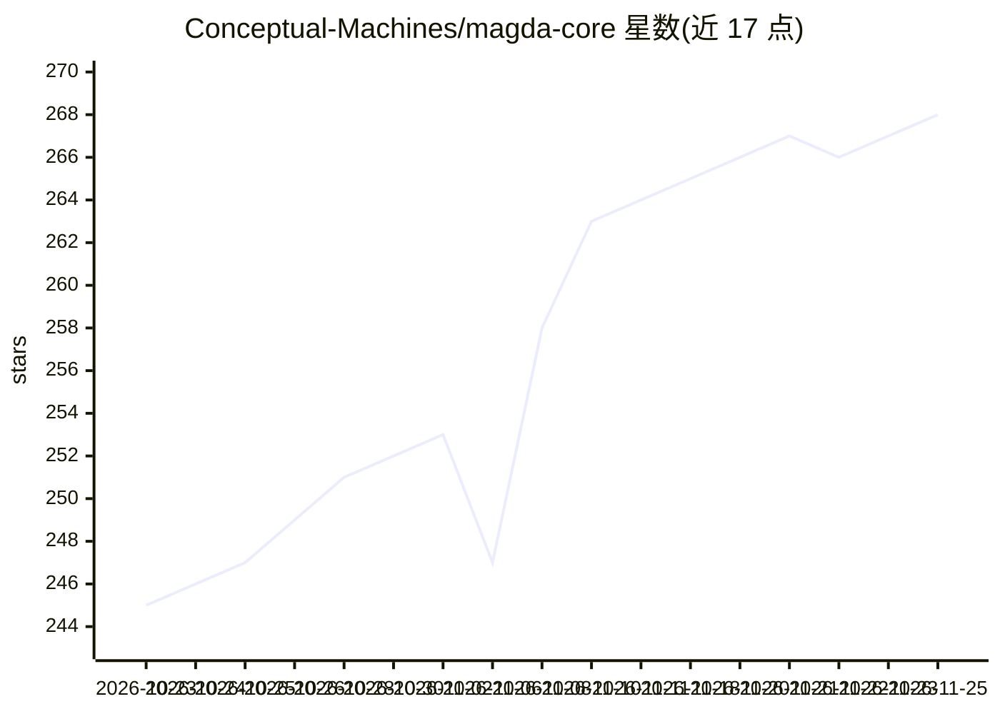

# Conceptual-Machines/magda-core

⭐ 268 · C++ · GPL-3.0 · 推送 2026-11-23 · [GitHub](https://github.com/Conceptual-Machines/magda-core) · [官网](https://magda.land/) · 组织维护 · 中文 README

**从底层集成 AI 的开源数字音频工作站（DAW）**

MAGDA 是一个基于 C++23 与 JUCE 构建的免费开源 DAW，使用原生音频引擎。功能包括音频/MIDI 混合轨道、Arrangement/Session/Mix 三视图、16 LFO 调制系统、可嵌套 Rack、钢琴卷帘、鼓机网格与调音台。AI 部分为内嵌聊天面板：自然语言命令生成并在应用内执行自定义 DSL（BYOAK 自带 API Key），并可通过 llama.cpp 子模块嵌入本地推理（可编译关闭）。提供 make 构建流程与 GitHub Actions CI。

## 筛选速览

| 维度 | 判定 | 备注 |
|---|---|---|
| AI 角色 | `ai-enhanced` | 去掉 AI 部分产品仍成立 |
| 许可风险 | `viral` | GPL-3.0 |
| 部署形态 | `None` |  |
| 模型依赖 | — | README 未给出锁定关系 |
| 硬件要求 | — | 无带数字的原话,不猜 |
| 安装摩擦 | `medium` | 含编译或系统依赖之一 |
| 成熟度 | `idea` | |

## 能力要点

- AI 聊天以自然语言生成并执行自定义 DSL（BYOAK）
- 可选嵌入 llama.cpp 本地 LLM 推理（CMake 开关可关闭）
- 混合轨道、16 LFO+16 宏旋钮调制系统与可嵌套 Rack
-  GPL v3 许可，跨平台构建（Linux/macOS/Windows）

## 适用场景

- 用自然语言指令在 DAW 内生成和执行音频操作
- 进行音频与 MIDI 混合的多轨编曲与混音
- 本地离线运行嵌入 LLM 的音乐制作环境

## 场景标签

 · 领域:音频/音乐制作软件

## 证据(README 行号)

> L12: MAGDA is a free, open-source DAW with AI integrated from the ground up. Built on C++23, JUCE, and MAGDA’s native au
> L19: - **AI chat**: natural language commands that generate and execute a custom DSL directly in the app (BYOAK, Bring Y
> L129: - llama.cpp - Embedded local LLM inference

## 星数曲线

2026-10-23 245 → 2026-11-25 268（+23）

---
*卡片 v1 · prompt 1.4 · 生成 2026-11-25 · 置信度 high · 依据 README sha `7129d65104db` · [字段定义](../../DATASET.md)*
