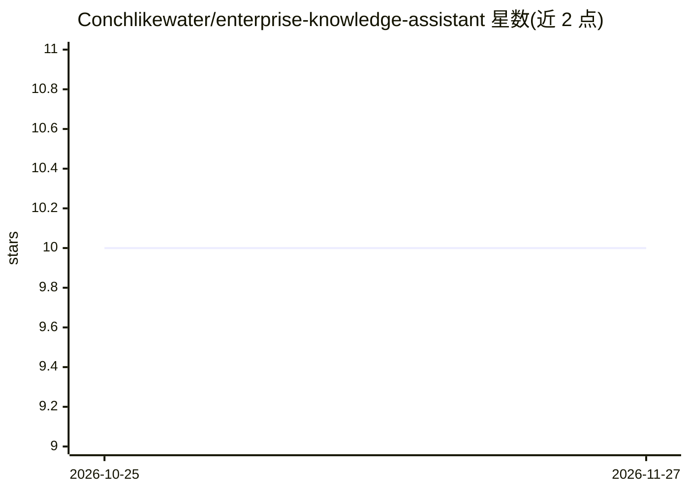

# Conchlikewater/enterprise-knowledge-assistant

⭐ 10 · Python · MIT · 推送 2026-09-11 · [GitHub](https://github.com/Conchlikewater/enterprise-knowledge-assistant) · 个人维护 · 中文 README

**面向文档问答的企业级 RAG API：可追溯引用、拒答与异步摄取**

以 FastAPI、SQLite 和 Qdrant 构建的 RAG 知识问答后端，支持 TXT/PDF 摄取、限定文档范围检索、基于证据的回答与应用侧结构化引用（文件名/页码/chunk ID/分数），Evidence 不足时拒答或至多一次确定性改写。提供同步 V1 与持久化 Job、独立 Worker、固定崩溃点恢复的异步 V2 摄取。附 10 份合成文档 50 题的离线评估、参数消融、Hybrid 负向实验与 OpenAI/DeepSeek 在线对比脚本。README 声明面向本地单用户演示，无认证、多租户或公网部署能力。

## 筛选速览

| 维度 | 判定 | 备注 |
|---|---|---|
| AI 角色 | `ai-native` | 本体是模型或模型工具 |
| 许可风险 | `permissive` | MIT |
| 部署形态 | `desktop` | 安装包/桌面程序 |
| 模型依赖 | locked-api |  |
| 硬件要求 | — | 无带数字的原话,不猜 |
| 安装摩擦 | `low` | 无编译、无系统依赖或容器化 |
| 成熟度 | `idea` | |

## 能力要点

- 文档范围检索与应用侧可追溯引用（chunk ID、页码、分数）
- 异步摄取：持久化 Job、独立 Worker、原子领取与固定崩溃点恢复
- 三分类受限路由：拒答优先、事实问题默认检索、检索上限 2 次
- 离线评估不需 API Key；OpenAI/DeepSeek 通过同一 LLMProvider 接口切换

## 适用场景

- 对上传的课程或制度文档做带引用的问答
- 验证证据不足时拒答与检索路由的边界行为
- 本地运行同步/异步摄取管道与离线检索评估

## 场景标签

`RAG` `文档问答` · 领域:知识与检索

## 证据(README 行号)

> L3: **一句话介绍：** 面向高校公开课程资料（课程大纲、学分、先修关系等）的 RAG 知识问答后端作品集，以 FastAPI、SQLite 和 Qdrant 实现可追溯问答与异步摄取，重点展示 AI 应用/Python 后端工程能力和
> L5: **一分钟介绍：** 本项目以高校公开课程资料为具体应用与检索实验场景，后端支持 TXT/PDF 摄取、限定文档检索、证据约束回答和应用侧引用。工程上保留同步接口，并提供持久化 Job、独立 Worker 和固定崩溃点恢复；实验上使
> L206: |`POST /api/v1/answers`|返回基于检索证据的回答和结构化引用|

## 星数曲线

2026-10-25 10 → 2026-11-27 10（+0）

---
*卡片 v1 · prompt 1.4 · 生成 2026-11-20 · 置信度 high · 依据 README sha `55ae3f3f3989` · [字段定义](../../DATASET.md)*
