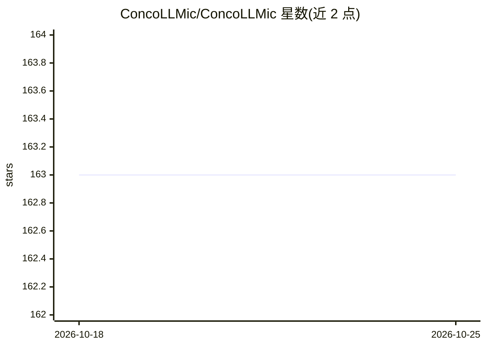

# ConcoLLMic/ConcoLLMic

⭐ 163 · Python · NOASSERTION · 推送 2026-09-08 · [GitHub](https://github.com/ConcoLLMic/ConcoLLMic) · [官网](https://concollmic.github.io/) · 组织维护

**LLM agent 驱动的语言无关 concolic 执行测试引擎**

用 LLM agent 执行 concolic 测试的引擎：先在源码级插入日志语句做插桩，随后 agent 以自然语言/代码/SMT 公式总结路径约束并求解，生成测试用例，无需为每种语言手工实现符号解释器或环境建模。支持 C/C++/Python/Java 等多语言及浮点、字符串等约束理论。默认使用 Claude Sonnet，需 ANTHROPIC_API_KEY，按 token 计费（示例两轮约 $0.40）。通过 git clone 加 pip 依赖安装，以 Python CLI（ACE.py）运行，另有 Docker 实验环境。

## 筛选速览

| 维度 | 判定 | 备注 |
|---|---|---|
| AI 角色 | `ai-ecosystem` | LLM/agent 周边工具 |
| 许可风险 | `none` | NOASSERTION |
| 部署形态 | `library` | 以包/库形式分发 |
| 模型依赖 | locked-api |  |
| 硬件要求 | — | 无带数字的原话,不猜 |
| 安装摩擦 | `medium` | 含编译或系统依赖之一 |
| 成熟度 | — | 结构信号不足 |

## 能力要点

- 源码级自动插桩 + LLM agent 总结并求解路径约束
- 语言与约束理论无关，支持 C/C++/Python/Java 及多语言系统
- 统一 CLI：instrument/run/replay/统计命令
- 提供 Docker 化大规模实验与对比工具（KLEE、AFL++、SymCC 等）设置

## 适用场景

- 对多语言项目自动生成测试用例并提升分支覆盖
- 复现论文实验或与 KLEE/AFL++ 等工具对比
- 用 gcov 回放测试用例并统计覆盖率与成本

## 场景标签

`网络安全` · 领域:学习与行业

## 证据(README 行号)

> L7: ConcoLLMic is the first language- and theory-agnostic concolic executor powered by LLM agents. Unlike traditional sy
> L13: **How it works**: ConcoLLMic uses LLM agents to
> L16: 3. solve constraints intelligently — directly reasoning constraints over semantics and delegating to grounded solve

## 星数曲线

2026-10-18 163 → 2026-10-25 163（+0）

---
*卡片 v1 · prompt 1.4 · 生成 2026-10-22 · 置信度 mid · 依据 README sha `f926cebeef8f` · [字段定义](../../DATASET.md)*
