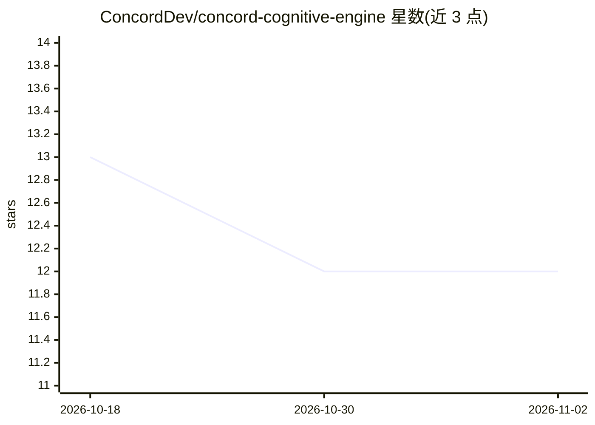

# ConcordDev/concord-cognitive-engine

⭐ 12 · JavaScript · NOASSERTION · 推送 2026-11-01 · [GitHub](https://github.com/ConcordDev/concord-cognitive-engine) · [官网](https://concord-os.org) · 个人维护

**给工程师的可验证计算引擎：AI 问答附求解器凭据与手算校核**

面向结构与机械工程师及研发团队的 Web 平台：用户用自然语言提问，语言模型负责读题、选引擎与解释，数值由确定性求解器计算（梁挠度、FEA 框架、44 项工程运算），每个答案附带求解器版本、输入假设、闭式手算校核与可复现记录（analysisReceipt 含输入哈希）。后端提供 267 个 lens 工作区与 MCP 服务器供其他 agent 调用。限制：商业使用需商业许可，pre-revenue 阶段无付费用户。

## 筛选速览

| 维度 | 判定 | 备注 |
|---|---|---|
| AI 角色 | `ai-native` | 本体是模型或模型工具 |
| 许可风险 | `none` | NOASSERTION |
| 部署形态 | `None` |  |
| 模型依赖 | — | README 未给出锁定关系 |
| 硬件要求 | — | 无带数字的原话,不猜 |
| 安装摩擦 | `low` | 无编译、无系统依赖或容器化 |
| 成熟度 | — | 结构信号不足 |

## 能力要点

- 问答路由到确定性求解器，语言模型不生成数值
- 每个计算结果附 solver 版本、假设、闭式手算校核与可复现凭据
- 12 例闭式教科书 V&V 语料在 CI 中以 1e-6 相对误差门禁
- MCP 服务器（OAuth 2.1 + PKCE）向其他 agent 暴露 131 个验证工具

## 适用场景

- 我需要快速校核梁/柱/框架计算并留下可归档的计算记录
- 工程团队要求 AI 计算结果可复算、可审计而非黑箱数值
- 让其他 AI agent 通过 MCP 调用同一套验证计算工具

## 场景标签

 · 领域:工程计算/AI 平台

## 证据(README 行号)

> L5: Ask an engineering question in plain English. Concord runs a real solver, puts the result next to the textbook hand 
> L26: Concord's rule: **where software can compute the answer exactly, it computes it.** The language model reads the que
> L105: **What is live:** the web app at concord-os.org, chat with deterministic engineering compute, the Engineering lens

## 星数曲线

2026-10-18 13 → 2026-11-02 12（-1）

---
*卡片 v1 · prompt 1.4 · 生成 2026-11-01 · 置信度 high · 依据 README sha `2674c4d0dcde` · [字段定义](../../DATASET.md)*
