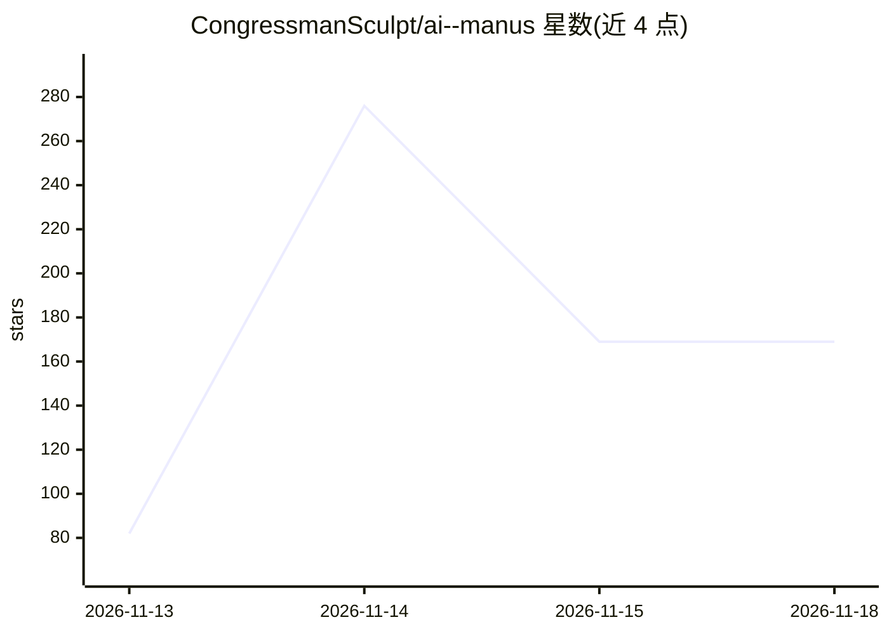

# CongressmanSculpt/ai--manus

⭐ 169 · Apache-2.0 · 推送 2026-11-15 · [GitHub](https://github.com/CongressmanSculpt/ai--manus) · 个人维护

**面向个人用户的自主 AI Agent：代跑代码与操控浏览器**

README 描述 Manus 为自主 AI agent，代替用户执行代码与浏览器操作：编写并运行脚本、打开网页、填写表单、执行多步骤任务。定位为家庭、学习与轻量办公场景的个人助手，而非企业平台，声明无需开发者背景。README 提供兼容性表（建议 8GB 内存、现代多核 CPU）与六步上手流程，但未给出任何具体安装命令、代码仓库内容或所依赖模型/SDK 的技术细节，通篇为功能宣传性文本，可验证的实现信息有限。

## 筛选速览

| 维度 | 判定 | 备注 |
|---|---|---|
| AI 角色 | `ai-native` | 本体是模型或模型工具 |
| 许可风险 | `permissive` | Apache-2.0 |
| 部署形态 | `None` |  |
| 模型依赖 | — | README 未给出锁定关系 |
| 硬件要求 | — | 无带数字的原话,不猜 |
| 安装摩擦 | `low` | 无编译、无系统依赖或容器化 |
| 成熟度 | — | 结构信号不足 |

## 能力要点

- 自主执行代码与脚本运行
- 浏览器控制：导航网页、填表、采集信息
- 代码与浏览器操作可在同一任务流中衔接
- 声明支持跨会话的任务模式记忆

## 适用场景

- 让学生整理研究笔记并运行小脚本
- 代替人工浏览多个网页收集信息并做汇总
- 把重复性的小型日常任务委托给后台 agent 执行

## 场景标签

`AI 助手` `浏览器自动化` · 领域:效率与自动化

## 证据(README 行号)

> L10: - **Autonomous Code Execution:** Manus AI agent runs code on its own to complete tasks, so you can focus on decisio
> L18: Manus is an autonomous AI agent designed to run code and control a browser on your behalf. Instead of acting like a

## 星数曲线

2026-11-13 82 → 2026-11-18 169（+87）

---
*卡片 v1 · prompt 1.4 · 生成 2026-11-17 · 置信度 low · 依据 README sha `0f78ee3a5dd2` · [字段定义](../../DATASET.md)*
