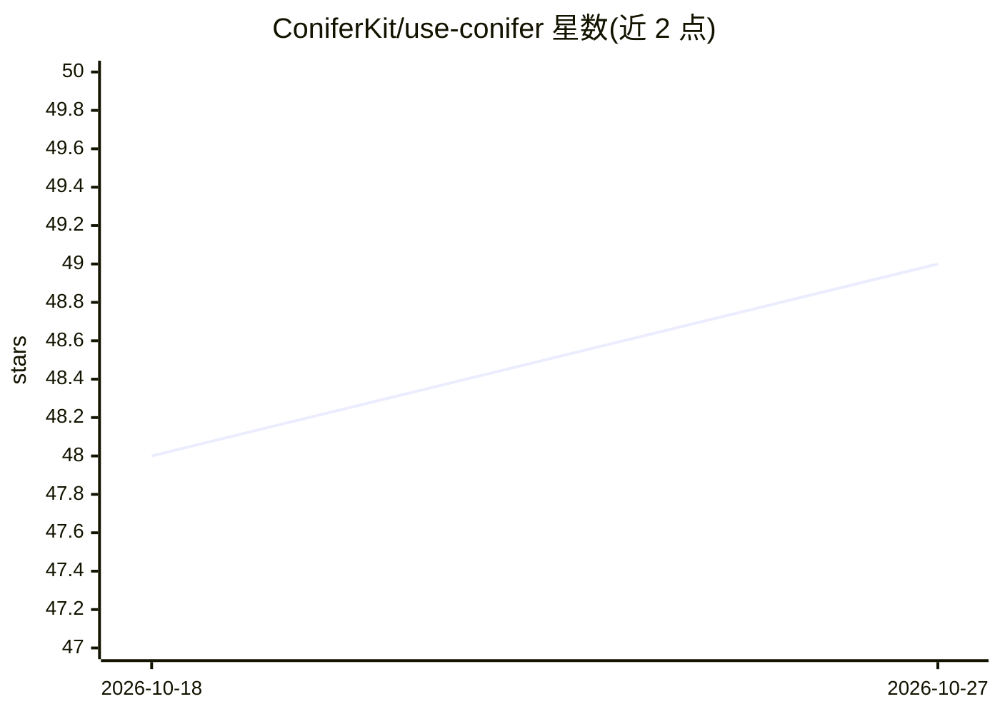

# ConiferKit/use-conifer

⭐ 49 · TypeScript · Apache-2.0 · 推送 2026-10-19 · [GitHub](https://github.com/ConiferKit/use-conifer) · [官网](https://conifer.build/docs/sdk/) · 组织维护

**统一 API 网关的 SDK：单 key 接入多家模型并返回逐次调用成本**

Conifer 是一个 LLM API 网关，提供单一 API key 与 base URL，背后聚合 OpenAI、Anthropic、Google、DeepSeek、Moonshot 等厂商模型，兼容 OpenAI/Anthropic API 协议，可让 Cursor、Cline、Claude Code 等自定义 base URL 的客户端直接接入。本仓库是其可选 SDK：TypeScript 与 Python 客户端及 MCP server。关键机制：以整数纳美元返回每次调用的精确成本回执（非 token 估算）、按请求的硬性支出上限 maxCostNanoUsd、model:auto 路由按难度选模型、embeddings 接口（base64 传输解码）、延迟任务（defer）接口。限制：流式响应无成本 header、macOS Python 需保留 [tls] extra。

## 筛选速览

| 维度 | 判定 | 备注 |
|---|---|---|
| AI 角色 | `ai-ecosystem` | LLM/agent 周边工具 |
| 许可风险 | `permissive` | Apache-2.0 |
| 部署形态 | `library` | 以包/库形式分发 |
| 模型依赖 | locked-api |  |
| 硬件要求 | — | 无带数字的原话,不猜 |
| 安装摩擦 | `low` | 无编译、无系统依赖或容器化 |
| 成熟度 | — | 结构信号不足 |

## 能力要点

- 以整数纳美元返回每次调用的精确成本回执
- maxCostNanoUsd 按请求硬性支出上限，超限在调用前拒绝
- model:auto/balanced/best 路由策略自动选模型并返回 fallback
- TypeScript + Python 客户端及 MCP server，base64 无损传输解码 embeddings

## 适用场景

- 用单一 key 和 base URL 接入多家厂商模型，替代多个 API key
- 为每次 LLM 调用记录精确成本并设支出上限
- 把现有工具（Cursor、Claude Code 等）指向网关不改代码
- 批量重索引、评测等非交互任务用 defer 提交后收集

## 场景标签

`模型网关` · 领域:Agent 开发

## 证据(README 行号)

> L22: Conifer is an API gateway. You get one API key and one base URL, and behind it
> L37: That is the whole product. This repo is the optional SDK for people who want

## 星数曲线

2026-10-18 48 → 2026-10-27 49（+1）

---
*卡片 v1 · prompt 1.4 · 生成 2026-10-25 · 置信度 high · 依据 README sha `57dcb9667d7a` · [字段定义](../../DATASET.md)*
