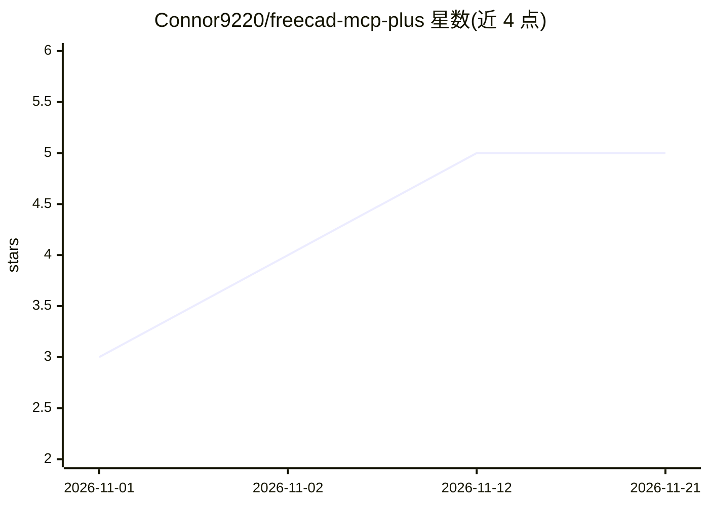

# Connor9220/freecad-mcp-plus

⭐ 5 · Python · MIT · 推送 2026-11-19 · [GitHub](https://github.com/Connor9220/freecad-mcp-plus) · 个人维护

**让 AI 助手在 FreeCAD 会话中建模与操作 CAM 的 MCP 桥接**

以 FreeCAD 插件形式安装的 MCP 桥：AI 客户端通过内置 MCP 服务器（用 uv 运行）连接到运行中的 FreeCAD 会话，可执行 150+ 工具，包括建模、运行 Python、驱动 GUI、审阅 CAM 作业。安全机制包括每用户 token 的 HMAC 签名、拒绝浏览器来源请求、AI 代码运行前的弹窗审批。支持 Linux/Windows/macOS，鼠标键盘类工具仅限 Linux X11。通过 Addon Manager 或 git 安装。

## 筛选速览

| 维度 | 判定 | 备注 |
|---|---|---|
| AI 角色 | `ai-ecosystem` | LLM/agent 周边工具 |
| 许可风险 | `permissive` | MIT |
| 部署形态 | `None` |  |
| 模型依赖 | — | README 未给出锁定关系 |
| 硬件要求 | — | 无带数字的原话,不猜 |
| 安装摩擦 | `low` | 无编译、无系统依赖或容器化 |
| 成熟度 | — | 结构信号不足 |

## 能力要点

- 150+ MCP 工具覆盖建模、宏开发、CAM（路径统计、G-code diff、过切检查）
- GUI 驱动：模拟用户操作工具栏、任务面板与模态对话框
- 安全机制：HMAC token 签名、AI 代码运行前 GUI 审批、无遥测
- 超时任务经 job_token 分页读取剩余输出

## 适用场景

- 让 Claude Code 等 MCP 客户端在实时 FreeCAD 会话中建模与改图
- AI 辅助生成并校验 CAM 刀路与 G-code
- 在 GUI 中由 AI 代为操作工具栏与任务面板

## 场景标签

 · 领域:工业设计/CAD 工具链

## 证据(README 行号)

> L7: MCP+ lets AI assistants (Claude Code and other MCP clients) work in
> L29: Install it with FreeCAD's Addon Manager or with git (see Installation). The MCP
> L101: - **150+ MCP Tools**: Comprehensive CAD operations including primitives, PartDesign, booleans, export

## 星数曲线

2026-11-01 3 → 2026-11-21 5（+2）

---
*卡片 v1 · prompt 1.4 · 生成 2026-11-21 · 置信度 high · 依据 README sha `f8244021de90` · [字段定义](../../DATASET.md)*
