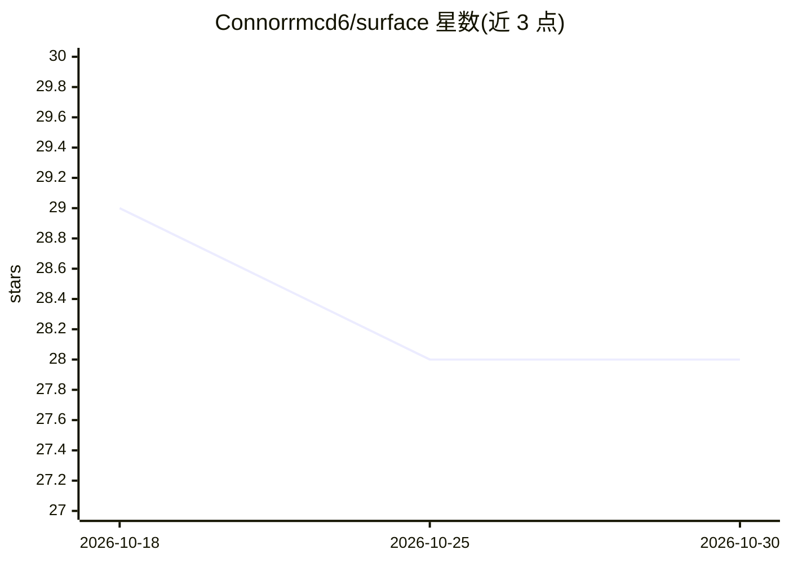

# Connorrmcd6/surface

⭐ 28 · Rust · Apache-2.0 · 推送 2026-10-24 · [GitHub](https://github.com/Connorrmcd6/surface) · [官网](https://surface.gradientdev.xyz) · 个人维护

**文档新鲜度守门工具：代码逻辑变更时强制人工重确认文档**

面向开发与 CI 场景的 docs-as-code 工具：将文档句子通过 anchors 锚定到具体代码符号，`surf check` 对符号做纯逻辑指纹比对（忽略格式/注释/重命名），逻辑变更即阻塞合并，直到人工 `surf verify` 重新确认。hub 符合 Google 的 OKF 格式，可被任意 OKF 消费端读取。核心确定性、无模型无网络无 API key；LLM 审阅仅为可选插件。提供 GitHub Action、安装脚本与 macOS/Linux 预编译二进制，不支持 Windows。

## 筛选速览

| 维度 | 判定 | 备注 |
|---|---|---|
| AI 角色 | `ai-enhanced` | 去掉 AI 部分产品仍成立 |
| 许可风险 | `permissive` | Apache-2.0 |
| 部署形态 | `library` | 以包/库形式分发 |
| 模型依赖 | — | README 未给出锁定关系 |
| 硬件要求 | — | 无带数字的原话,不猜 |
| 安装摩擦 | `low` | 无编译、无系统依赖或容器化 |
| 成熟度 | — | 结构信号不足 |

## 能力要点

- claim 锚定代码符号，逻辑指纹变化即阻塞 CI 合并
- 对格式/注释/一致重命名静默，对逻辑变更报警
- hub 符合 OKF（Open Knowledge Format），可移植到任意 OKF 消费端
- 核心确定性：无模型、无网络、无 API key

## 适用场景

- 在 CI 中检测架构文档/AGENTS.md 与代码逻辑的漂移
- 为 AI agent 维护可信且不过期的代码库文档
- 把文档验证纳入 docs-as-code 流程，像测试一样治理文档

## 场景标签

 · 领域:开发工具/文档工程

## 证据(README 行号)

> L12: Deterministic. No model, no network, no API key in the core.
> L5: Agents read your docs on every run, and they can't tell a current doc from a rotted one. Surface
> L33: Surface closes that gap two ways: **`hubs/`** give documentation a standard home so people and

## 星数曲线

2026-10-18 29 → 2026-10-30 28（-1）

---
*卡片 v1 · prompt 1.4 · 生成 2026-10-26 · 置信度 high · 依据 README sha `ddd00355e05c` · [字段定义](../../DATASET.md)*
