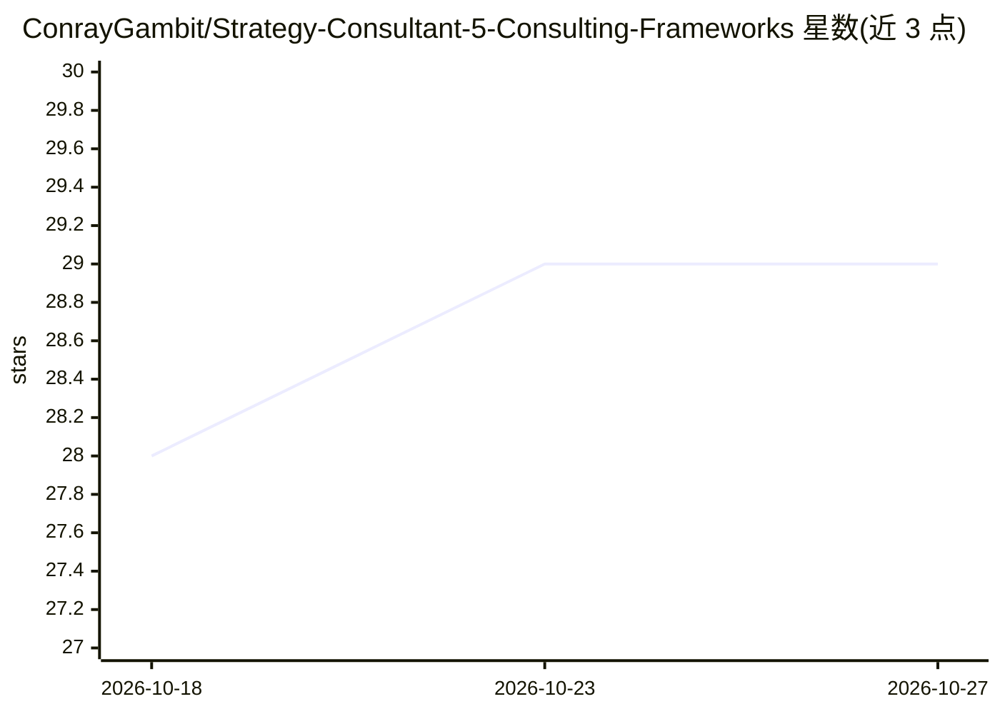

# ConrayGambit/Strategy-Consultant-5-Consulting-Frameworks

⭐ 29 · Python · MIT · 推送 2026-05-23 · [GitHub](https://github.com/ConrayGambit/Strategy-Consultant-5-Consulting-Frameworks) · [官网](https://youtube.com/@conraygambit) · 个人维护

**把战略咨询五框架打包成 Claude Skills 与通用 LLM 提示词**

将 MECE、议题树、假设检验、帕累托、So What? 五个咨询框架打包为 Anthropic Skills 格式（SKILL.md）与可粘贴的通用提示词，供 Claude Code/Cowork 自动加载或在任意 LLM（Claude.ai、ChatGPT、Gemini、本地模型）中作为系统提示使用。每个商业问题按固定视觉契约产出五个部分（嵌套要点、ASCII 树、对比表、引用块、Process/Result/Insight）。另提供 7 框架变体（加 5 Whys 与金字塔原理）、子代理版及多个行业包（SaaS、零售、医疗等，置于 industry-packs/ 目录，快速安装命令不覆盖）。安装方式为 git clone 后复制 skills/ 目录。

## 筛选速览

| 维度 | 判定 | 备注 |
|---|---|---|
| AI 角色 | `ai-ecosystem` | LLM/agent 周边工具 |
| 许可风险 | `permissive` | MIT |
| 部署形态 | `None` |  |
| 模型依赖 | — | README 未给出锁定关系 |
| 硬件要求 | — | 无带数字的原话,不猜 |
| 安装摩擦 | `low` | 无编译、无系统依赖或容器化 |
| 成熟度 | — | 结构信号不足 |

## 能力要点

- 双格式分发：Anthropic Skills（SKILL.md+frontmatter）与即贴提示词，内容同源
- 固定视觉输出契约：MECE 要点、ASCII 议题树、假设对比表、帕累托引用块、So What? 收尾
- 7 框架变体与子代理（并行委托）版，以及 SaaS/零售/医疗/金融等 8 个行业包
- examples/ 含跨行业真实输出样例与安装测试标准（TESTING.md）

## 适用场景

- 创始人/运营者在不请顾问的情况下用咨询框架拆解商业问题
- PM 和分析师在汇报前结构化梳理流失、转化等混乱调查
- MBA 学生与案例面试候选人在 LLM 中练习五框架
- 工程经理用固定结构做事故复盘或容量评审

## 场景标签

`提示工程` · 领域:Agent 开发

## 证据(README 行号)

> L13: The idea: most LLMs answer business questions in flowing prose that sounds smart but doesn't actually structure you
> L77: - **`skills/<skill-name>/SKILL.md`** — Anthropic Skills format with YAML frontmatter (name, description) and the ac
> L137: - **Dual format (skills + plain prompts).** Anthropic Skills format works in Claude Code/Cowork. Plain prompts wor

## 星数曲线

2026-10-18 28 → 2026-10-27 29（+1）

---
*卡片 v1 · prompt 1.4 · 生成 2026-10-26 · 置信度 high · 依据 README sha `d354a2293ede` · [字段定义](../../DATASET.md)*
