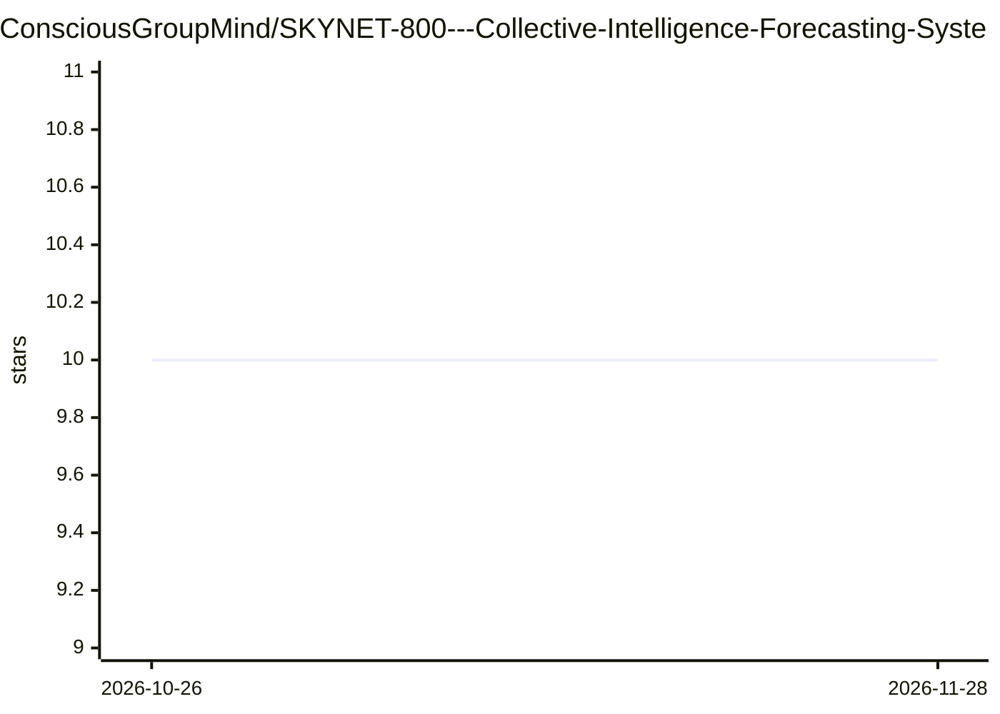

# ConsciousGroupMind/SKYNET-800---Collective-Intelligence-Forecasting-System

⭐ 10 · Python · NOASSERTION · 推送 2026-10-19 · [GitHub](https://github.com/ConsciousGroupMind/SKYNET-800---Collective-Intelligence-Forecasting-System) · 个人维护

**给交易分析者的加密货币价格时间点与曲线预测代码**

一个 Python 编写的时间序列预测与熵分析项目，声称预测未来价格的具体时间点并构建未来价格曲线，也可用于分析任何可绘成曲线的过程。数据存储与处理迁移到 ClickHouse 列式数据库；作者声明预测不调用 DeepSeek 算力，在普通计算机上运行。项目处于 BETA 阶段（v0.2 UNDER REPAIR），仅在 Windows + Python 3.11 + ClickHouse 18.16.1 下开发测试，依赖通过 requirements.txt 安装，环境配置问题建议咨询 DeepSeek，作者不提供本地环境支持。

## 筛选速览

| 维度 | 判定 | 备注 |
|---|---|---|
| AI 角色 | `ai-native` | 本体是模型或模型工具 |
| 许可风险 | `none` | NOASSERTION |
| 部署形态 | `library` | 以包/库形式分发 |
| 模型依赖 | — | README 未给出锁定关系 |
| 硬件要求 | — | 无带数字的原话,不猜 |
| 安装摩擦 | `low` | 无编译、无系统依赖或容器化 |
| 成熟度 | `idea` | |

## 能力要点

- 预测未来价格时间点并构建价格曲线的时间序列数学框架
- 数据存储与处理迁移至 ClickHouse 列式数据库
- 代码在 DeepSeek 对话中编写，预测本身不使用其算力

## 适用场景

- 在个人电脑上对加密货币价格做时间序列预测实验
- 对可绘制曲线的过程做时间序列分析
- 研究随机数生成器的熵分析

## 场景标签

`金融量化` · 领域:学习与行业

## 证据(README 行号)

> L2: This code predicts the exact time and price of a future price point, and can also construct a curve of future prices
> L6: ### My project is a mathematical framework for time series forecasting and entropy analysis. Just as large language 
> L27: **⚠️ CRITICAL: This project runs ONLY on Python 3.11 and ClickHouse 18.16.1.**

## 星数曲线

2026-10-26 10 → 2026-11-28 10（+0）

---
*卡片 v1 · prompt 1.4 · 生成 2026-11-20 · 置信度 mid · 依据 README sha `ba892221ace2` · [字段定义](../../DATASET.md)*
