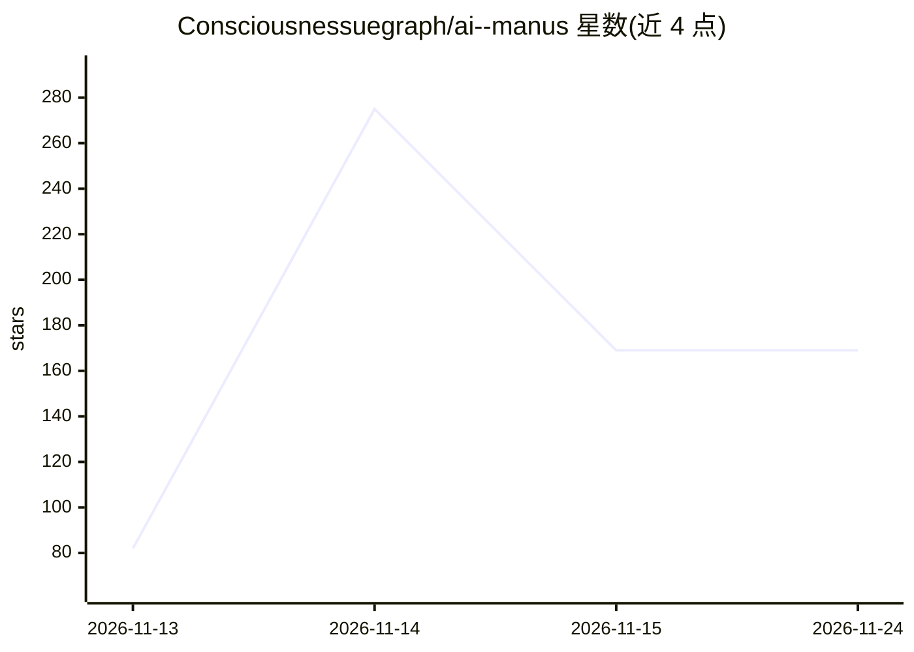

# Consciousnessuegraph/ai--manus

⭐ 169 · Apache-2.0 · 推送 2026-11-15 · [GitHub](https://github.com/Consciousnessuegraph/ai--manus) · 个人维护

**面向个人用户的自主 AI Agent：代为执行代码与浏览器操作**

README 描述 Manus 为自主 AI 代理，可代替用户编写并执行脚本、控制浏览器（导航网页、填写表单、采集信息），并执行多步骤日常任务，定位为家庭、学习与轻量办公场景的个人助手，非企业平台。给出最低 4 GB 内存、双核 CPU 的兼容性表。但 README 未提供任何安装命令、下载渠道细节或模型接入方式，仅含营销式功能描述与搜索词列表，可验证的技术信息有限。

## 筛选速览

| 维度 | 判定 | 备注 |
|---|---|---|
| AI 角色 | `ai-native` | 本体是模型或模型工具 |
| 许可风险 | `permissive` | Apache-2.0 |
| 部署形态 | `None` |  |
| 模型依赖 | — | README 未给出锁定关系 |
| 硬件要求 | — | 无带数字的原话,不猜 |
| 安装摩擦 | `low` | 无编译、无系统依赖或容器化 |
| 成熟度 | — | 结构信号不足 |

## 能力要点

- 自主执行代码与脚本
- 浏览器控制：导航、填表、信息采集
- 代码与浏览器操作可在同一任务流中衔接
- 面向多步骤、低监督的日常任务

## 适用场景

- 让代理代替我查网页、填表和收集资料
- 自动执行小型脚本和文件整理等重复任务
- 学习与轻办公中委派琐碎工作

## 场景标签

`AI 助手` `浏览器自动化` `编码 Agent` · 领域:效率与自动化

## 证据(README 行号)

> L10: - **Autonomous Code Execution:** Manus AI agent runs code on its own to complete tasks, so you can focus on decisio
> L18: Manus is an autonomous AI agent designed to run code and control a browser on your behalf. Instead of acting like a

## 星数曲线

2026-11-13 82 → 2026-11-24 169（+87）

---
*卡片 v1 · prompt 1.4 · 生成 2026-11-17 · 置信度 low · 依据 README sha `0f78ee3a5dd2` · [字段定义](../../DATASET.md)*
