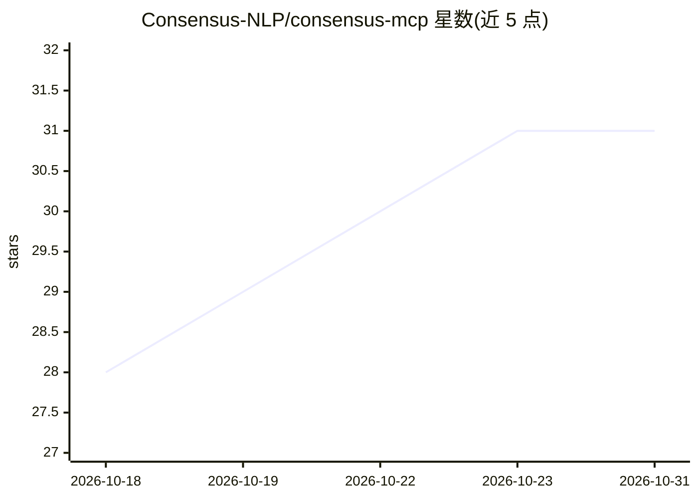

# Consensus-NLP/consensus-mcp

⭐ 31 · MIT · 推送 2026-08-26 · [GitHub](https://github.com/Consensus-NLP/consensus-mcp) · [官网](https://mcp.consensus.app/mcp) · 组织维护

**Consensus 学术搜索的官方 MCP 服务器，供 AI 客户端检索 2.2 亿+论文**

由 Consensus 维护的托管式远程 MCP 服务器：Claude、ChatGPT、Cursor、Claude Code、Codex、VS Code Copilot、Windsurf 等任意兼容远程 MCP（Streamable HTTP）的客户端可接入 https://mcp.consensus.app/mcp，在对话中检索 2.2 亿+同行评审论文。提供 search 工具，返回标题、作者、期刊、DOI、引用数、研究类型与要点，支持 RCT/元分析、样本量、SJR 分区等质量过滤。认证用 OAuth 或 API key，企业可用 Bearer token；另有 REST API。本地无需从源码安装。

## 筛选速览

| 维度 | 判定 | 备注 |
|---|---|---|
| AI 角色 | `ai-ecosystem` | LLM/agent 周边工具 |
| 许可风险 | `permissive` | MIT |
| 部署形态 | `None` |  |
| 模型依赖 | — | README 未给出锁定关系 |
| 硬件要求 | — | 无带数字的原话,不猜 |
| 安装摩擦 | `low` | 无编译、无系统依赖或容器化 |
| 成熟度 | — | 结构信号不足 |

## 能力要点

- 检索 220M+ 同行评审论文，含引用数、研究类型、SJR 分区等元数据
- 支持 RCT、元分析、样本量、期刊分区等质量过滤
- 托管远程服务器，支持任意 Streamable HTTP 客户端接入
- 另提供 REST API（api.consensus.app/v1/search）

## 适用场景

- 在 Claude/ChatGPT 对话中直接检索文献并给出可引用研究
- 限定 RCT 或元分析等研究类型做循证检索
- 企业为内部研究工作流或产品接入循证搜索

## 场景标签

`科研工具` `语义搜索` · 领域:知识与检索

## 证据(README 行号)

> L10: The Consensus MCP server connects AI assistants to Consensus, the academic search engine. Claude, ChatGPT, Cursor, 
> L106: Any client that supports remote MCP servers (Streamable HTTP) works. Point it at:
> L150: The Consensus MCP server is a hosted remote server; there is nothing to install from source. This repo is its publ

## 星数曲线

2026-10-18 28 → 2026-10-31 31（+3）

---
*卡片 v1 · prompt 1.4 · 生成 2026-10-26 · 置信度 high · 依据 README sha `52eb107d67f0` · [字段定义](../../DATASET.md)*
