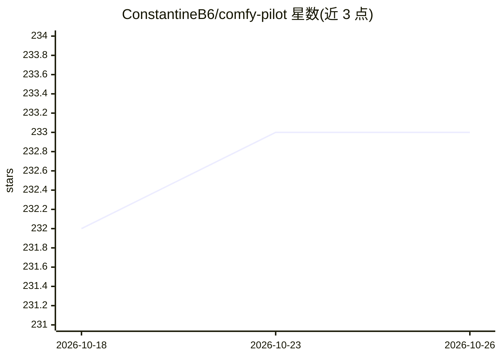

# ConstantineB6/comfy-pilot

⭐ 233 · Python · MIT · 推送 2026-02-16 · [GitHub](https://github.com/ConstantineB6/comfy-pilot) · 个人维护

**让 Claude Code 查看、编辑和运行 ComfyUI 工作流的 MCP 服务器与内嵌终端**

ComfyUI 自定义节点插件：内含 MCP 服务器与 xterm.js 嵌入式终端，使 Claude Code 直接在 ComfyUI 界面内查看、编辑、运行工作流。提供 get_workflow、edit_graph、run、view_image、download_model 等 12 个 MCP 工具，支持从 Hugging Face（含 gated 模型 token 认证）、CivitAI 或直链下载模型，并可经 ComfyUI Manager 注册表安装/卸载/更新自定义节点。要求 ComfyUI 与 Python 3.8+，未检测到 Claude Code CLI 时自动安装。面向使用 Claude Code 的 ComfyUI 用户。

## 筛选速览

| 维度 | 判定 | 备注 |
|---|---|---|
| AI 角色 | `ai-ecosystem` | LLM/agent 周边工具 |
| 许可风险 | `permissive` | MIT |
| 部署形态 | `None` |  |
| 模型依赖 | locked-api |  |
| 硬件要求 | — | 无带数字的原话,不猜 |
| 安装摩擦 | `low` | 无编译、无系统依赖或容器化 |
| 成熟度 | — | 结构信号不足 |

## 能力要点

- 12 个 MCP 工具：工作流读取/摘要、图编辑、运行控制、图像查看
- xterm.js 嵌入式终端在 ComfyUI 内运行 Claude Code
- 从 Hugging Face（含 gated 模型）、CivitAI 或直链下载模型
- 经 ComfyUI Manager 注册表安装/更新/卸载自定义节点

## 适用场景

- 用自然语言让 Claude Code 从零搭建 SDXL/FLUX 工作流
- 让 Claude 查看生成图片输出并调整节点参数
- 在 ComfyUI 界面内直接与 Claude Code 终端交互

## 场景标签

`工作流自动化` `图像生成` · 领域:效率与自动化

## 证据(README 行号)

> L7: Talk to your ComfyUI workflows. Comfy Pilot gives Claude Code direct access to see, edit, and run your workflows — w
> L49: - **MCP Server** - Gives Claude Code direct access to view, edit, and run your ComfyUI workflows
> L50: - **Embedded Terminal** - Full xterm.js terminal running Claude Code right inside ComfyUI

## 星数曲线

2026-10-18 232 → 2026-10-26 233（+1）

---
*卡片 v1 · prompt 1.4 · 生成 2026-10-22 · 置信度 high · 依据 README sha `de51b3d174b6` · [字段定义](../../DATASET.md)*
