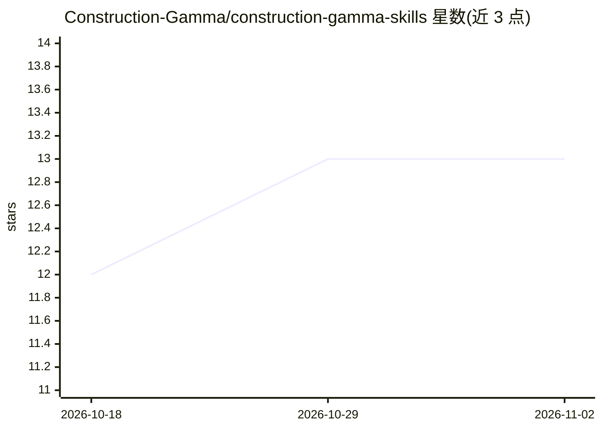

# Construction-Gamma/construction-gamma-skills

⭐ 13 · Python · NOASSERTION · 推送 2026-02-28 · [GitHub](https://github.com/Construction-Gamma/construction-gamma-skills) · [官网](https://constructiongamma.com/) · 组织维护

**面向建筑项目经理的 Claude 技能库：47 个领域技能加 5 个命令**

Construction Gamma 维护的建筑管理 Claude Cowork 技能库：包含 47 个领域技能，覆盖项目管理与协调（11 个）、工种与建筑系统（14 个）、建筑与项目类型（22 个，含医疗、教育、数据中心等）；另有 5 个斜杠命令（RFI 分析、日报汇总、业主更新、提交件审查、安全周报）。接入 Construction Gamma 平台后命令可拉取 Procore 项目实时数据；也可直接通过 marketplace 安装技能包，但不含实时数据。

## 筛选速览

| 维度 | 判定 | 备注 |
|---|---|---|
| AI 角色 | `ai-knowledge` | 知识聚合/清单类 |
| 许可风险 | `none` | NOASSERTION |
| 部署形态 | `None` |  |
| 模型依赖 | — | README 未给出锁定关系 |
| 硬件要求 | — | 无带数字的原话,不猜 |
| 安装摩擦 | `low` | 无编译、无系统依赖或容器化 |
| 成熟度 | — | 结构信号不足 |

## 能力要点

- 47 个建筑领域技能，覆盖项目管理、工种系统与 22 种项目类型
- 5 个斜杠命令：RFI 分析、日报、业主更新、提交件审查、安全周报
- 可选接入 Procore 实时项目数据

## 适用场景

- 建筑项目经理在 Claude Cowork 中分析 RFI 与生成日报
- 按项目类型（医疗、数据中心等）调用对应领域技能
- 通过命令生成业主汇报邮件与安全周报

## 场景标签

`提示工程` · 领域:Agent 开发

## 证据(README 行号)

> L3: AI-powered construction management skills for Claude Cowork by Construction Gamma.
> L7: ### 47 Domain Skills

## 星数曲线

2026-10-18 12 → 2026-11-02 13（+1）

---
*卡片 v1 · prompt 1.4 · 生成 2026-10-31 · 置信度 high · 依据 README sha `8312cb526dd3` · [字段定义](../../DATASET.md)*
