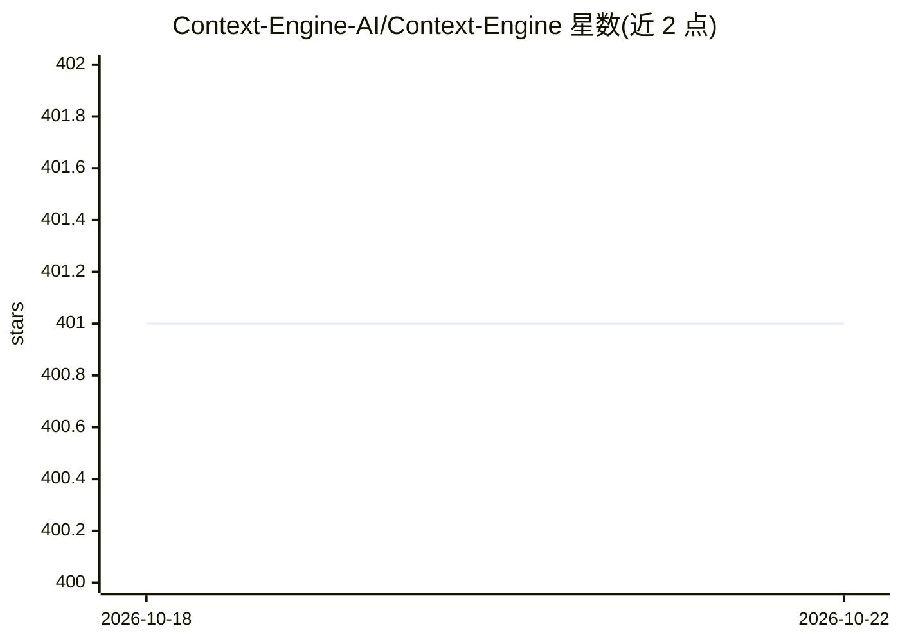

# Context-Engine-AI/Context-Engine

⭐ 401 · Python · MIT · 推送 2026-10-22 · [GitHub](https://github.com/Context-Engine-AI/Context-Engine) · [官网](https://context-engine.ai) · 组织维护

**为 AI 编程助手提供语义代码搜索与记忆的 MCP 工具套件**

面向 AI 编程助手的上下文工具集：通过 30+ MCP 工具提供语义代码搜索、符号图导航（调用者/被调用/定义/导入）、跨会话记忆、批量查询、跨仓库搜索、git 历史检索等能力。以 AI agent 技能文件形式安装到 Claude Code、Cursor、Codex、Windsurf、Gemini 等助手，另提供 npm CLI MCP bridge（ctxce）负责认证、代码索引与文件监听。需要注册账号获取 API key，代码库连接后经 stdio 或 HTTP 模式接入 MCP 客户端。

## 筛选速览

| 维度 | 判定 | 备注 |
|---|---|---|
| AI 角色 | `ai-ecosystem` | LLM/agent 周边工具 |
| 许可风险 | `permissive` | MIT |
| 部署形态 | `library` | 以包/库形式分发 |
| 模型依赖 | — | README 未给出锁定关系 |
| 硬件要求 | — | 无带数字的原话,不猜 |
| 安装摩擦 | `low` | 无编译、无系统依赖或容器化 |
| 成熟度 | — | 结构信号不足 |

## 能力要点

- 30+ MCP 工具：语义搜索、符号图、记忆存储、批量查询
- 技能文件适配 Claude Code / Cursor / Codex / Windsurf / Gemini 等助手
- CLI bridge 支持后台守护进程、文件变更监听与 stdio/HTTP 两种 MCP 模式
- 跨仓库搜索与 git 历史检索

## 适用场景

- 让我的编程助手用语义搜索代替关键词搜索理解代码库
- 跨多个仓库追踪调用链与依赖关系
- 让助手跨会话记住项目知识与上下文
- 通过批量查询减少 token 消耗

## 场景标签

`语义搜索` `Agent 记忆` · 领域:Agent 开发

## 证据(README 行号)

> L13: Context Engine ships AI agent skills that teach your coding assistant how to use 30+ MCP tools for semantic search,

## 星数曲线

2026-10-18 401 → 2026-10-22 401（+0）

---
*卡片 v1 · prompt 1.4 · 生成 2026-10-22 · 置信度 high · 依据 README sha `fbcc7f351cde` · [字段定义](../../DATASET.md)*
