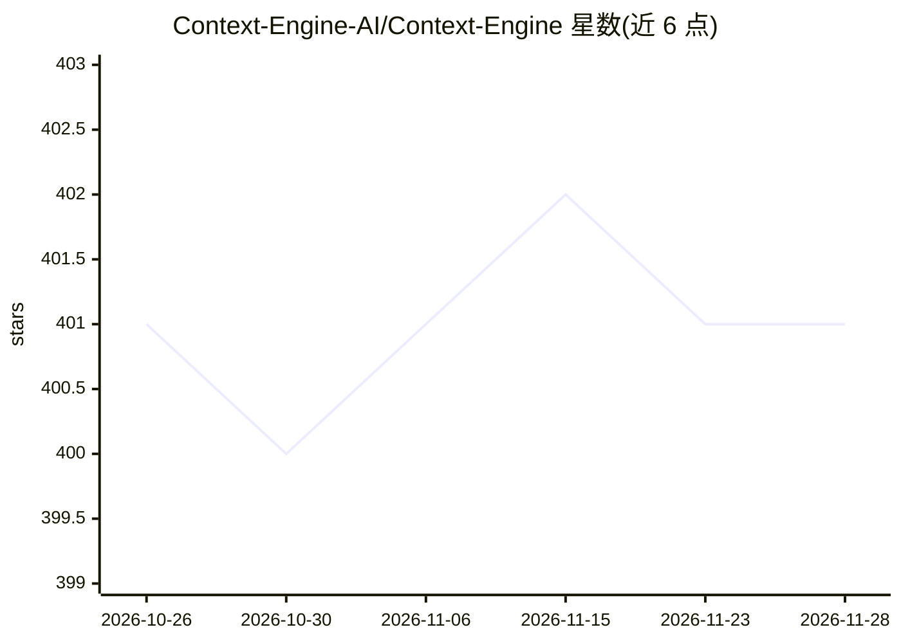

# Context-Engine-AI/Context-Engine

⭐ 401 · Python · MIT · 推送 2026-11-25 · [GitHub](https://github.com/Context-Engine-AI/Context-Engine) · [官网](https://context-engine.ai) · 组织维护

**为 AI 编码助手提供语义代码搜索与记忆的 MCP 工具套件**

提供 30+ 个 MCP 工具的技能包与桥接服务：语义代码搜索、符号图导航（调用者/被调用者/定义）、跨会话记忆存取、跨仓库流程追踪、git 历史搜索等，供 Claude Code、Cursor、Codex、Windsurf、Gemini 等编码助手接入使用。使用需在 context-engine.ai 注册账号获取 API key，通过 npm 安装的 CLI 桥接进程索引代码库并以 stdio 或 HTTP 模式暴露 MCP 服务器，后台守护进程持续监听文件变更。MIT 许可。

## 筛选速览

| 维度 | 判定 | 备注 |
|---|---|---|
| AI 角色 | `ai-ecosystem` | LLM/agent 周边工具 |
| 许可风险 | `permissive` | MIT |
| 部署形态 | `library` | 以包/库形式分发 |
| 模型依赖 | — | README 未给出锁定关系 |
| 硬件要求 | — | 无带数字的原话,不猜 |
| 安装摩擦 | `low` | 无编译、无系统依赖或容器化 |
| 成熟度 | — | 结构信号不足 |

## 能力要点

- 30+ 个 MCP 工具：语义搜索、符号图、记忆、跨仓库搜索、模式搜索、git 历史搜索
- 为 Claude Code、Codex、Cursor、Windsurf、Gemini 等提供各自的技能安装方式
- npm 全局安装 CLI 桥接，支持 stdio 与 HTTP 两种 MCP 模式
- 后台守护进程按间隔（默认 30 秒）监听文件变更并更新索引

## 适用场景

- 让 AI 编码助手优先用语义搜索替代 ls/grep 浏览代码库
- 跨多个仓库追踪调用流程
- 跨会话持久化项目知识（memory_store/memory_find）

## 场景标签

`语义搜索` `Agent 记忆` · 领域:Agent 开发

## 证据(README 行号)

> L5:  Semantic code search, memory, and symbol intelligence for AI coding assistants.
> L13: Context Engine ships AI agent skills that teach your coding assistant how to use 30+ MCP tools for semantic search,
> L97: If you use Claude Code, Codex, or another terminal-based MCP client, install the **MCP bridge** to connect your cod

## 星数曲线

2026-10-26 401 → 2026-11-28 401（+0）

---
*卡片 v1 · prompt 1.4 · 生成 2026-11-25 · 置信度 high · 依据 README sha `310e9a4c8702` · [字段定义](../../DATASET.md)*
