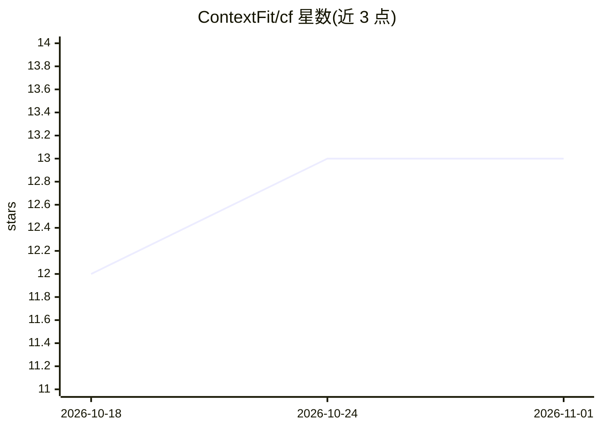

# ContextFit/cf

⭐ 13 · Python · 推送 2026-07-21 · [GitHub](https://github.com/ContextFit/cf) · [官网](https://www.context.fit/) · 个人维护

**面向 LLM 的 token 原生知识库与检索工具，免向量库**

以 Python 库/CLI 形式提供的知识库系统：存储、索引（倒排索引、后缀数组、token BM25）、图关系、层级遍历与共性发现全部在离散 token-ID 空间完成，仅在最后一步解码检索到的 chunk 供 LLM 输出，可直接以 input_ids 注入任意 LLM，不依赖 embedding API 与向量数据库。支持 Markdown/文本/TMD 账本/代码等多格式结构化分块、语义 ID（SID）生成与学习式 SID 检索，并提供本地 MCP stdio 服务器供 Claude Desktop 集成、OpenClaw 插件与带访问密钥的 HTTP 服务。项目自述处于早期开发（架构阶段）。

## 筛选速览

| 维度 | 判定 | 备注 |
|---|---|---|
| AI 角色 | `ai-ecosystem` | LLM/agent 周边工具 |
| 许可风险 | `none` | — |
| 部署形态 | `library` | 以包/库形式分发 |
| 模型依赖 | — | README 未给出锁定关系 |
| 硬件要求 | — | 无带数字的原话,不猜 |
| 安装摩擦 | `low` | 无编译、无系统依赖或容器化 |
| 成熟度 | `idea` | |

## 能力要点

- 全程 token-ID 空间的存储/索引/检索，无需 embedding API 与向量数据库
- 直接以 input_ids 注入 LLM，最后一步才解码
- 倒排索引(Roaring bitmaps)、FM-Index、token BM25、MinHash+LSH 图层与层级社区摘要
- 提供 MCP stdio 服务器、OpenClaw 集成与带访问密钥的 HTTP 服务

## 适用场景

- 为 LLM/agent 构建免向量库的本地知识库与检索层
- 通过 MCP 让 Claude Desktop 调用本地知识检索
- 以 TMD 账本等结构化格式做可溯源检索

## 场景标签

`Agent 记忆` `RAG` · 领域:Agent 开发

## 证据(README 行号)

> L5: ContextFit keeps everything—storage, indexing, search, relationships, traversal, and commonality detection—inside di
> L54: - Feed directly as `input_ids` to any LLM

## 星数曲线

2026-10-18 12 → 2026-11-01 13（+1）

---
*卡片 v1 · prompt 1.4 · 生成 2026-10-31 · 置信度 high · 依据 README sha `c2ada986502d` · [字段定义](../../DATASET.md)*
