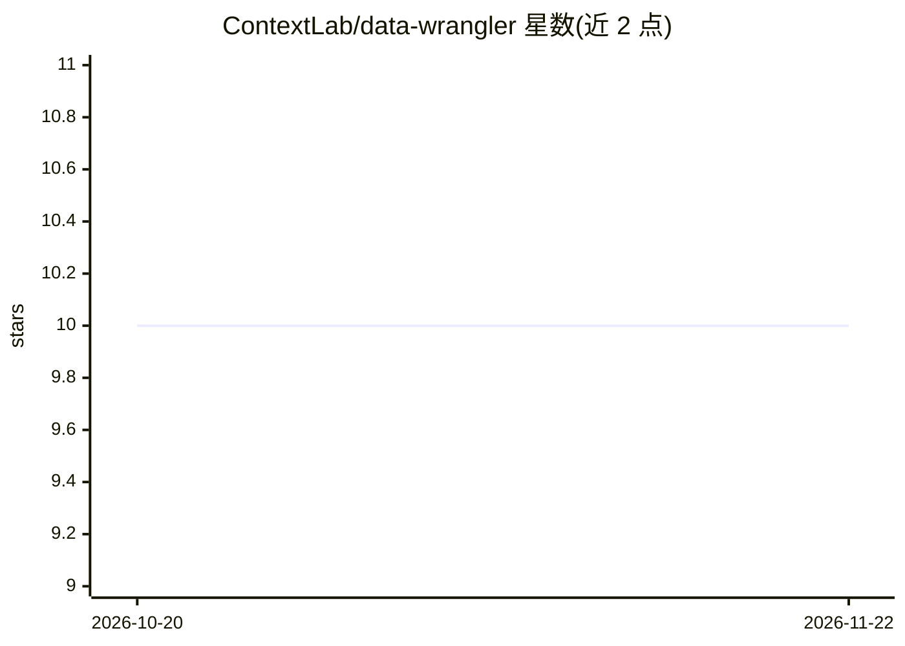

# ContextLab/data-wrangler

⭐ 10 · Python · MIT · 推送 2026-07-23 · [GitHub](https://github.com/ContextLab/data-wrangler) · 组织维护

**给数据科学者的脏数据清洗库：多格式数据统一转 DataFrame**

Python 数据整理包，将数组/图像、DataFrame、文本等 messy 数据转换为规范的 pandas 或 Polars DataFrame，支持缺失值插补与插值，并提供装饰器让普通函数自动兼容多种输入类型。文本数据通过接入 scikit-learn 与 hugging-face（经 sentence-transformers）的 NLP 模型生成嵌入，内置 minipedia 语料训练的 LDA 等简化 API；支持 backend='polars' 切换高性能后端。通过 pip 安装，文档与教程在 readthedocs。

## 筛选速览

| 维度 | 判定 | 备注 |
|---|---|---|
| AI 角色 | `ai-native` | 本体是模型或模型工具 |
| 许可风险 | `permissive` | MIT |
| 部署形态 | `library` | 以包/库形式分发 |
| 模型依赖 | — | README 未给出锁定关系 |
| 硬件要求 | — | 无带数字的原话,不猜 |
| 安装摩擦 | `low` | 无编译、无系统依赖或容器化 |
| 成熟度 | — | 结构信号不足 |

## 能力要点

- 多格式输入（数组/图像、DataFrame/Series、文本）统一转为 DataFrame
- 文本接入 scikit-learn 与 hugging-face（sentence-transformers）模型生成嵌入
- 支持 pandas 与 Polars 双后端，backend='polars' 零代码切换
- funnel 装饰器使函数自动支持新数据类型

## 适用场景

- 把格式杂乱、有缺失值的数值/文本数据清洗成规整 DataFrame
- 对文本做 LDA 或 sentence-transformers 嵌入用于后续分析
- 大数据集用 Polars 后端加速 wrangle 流程

## 场景标签

 · 领域:数据科学/数据预处理

## 证据(README 行号)

> L12: The main goal of ``data-wrangler`` is to turn messy data into clean(er) data, defined as either a ``DataFrame`` or 
> L24: The ``data-wrangler`` package supports a variety of datatypes. There is a special emphasis on text data, whereby
> L105:  - text data (text is embedded using natural language processing models)

## 星数曲线

2026-10-20 10 → 2026-11-22 10（+0）

---
*卡片 v1 · prompt 1.4 · 生成 2026-11-20 · 置信度 mid · 依据 README sha `8f855e328527` · [字段定义](../../DATASET.md)*
