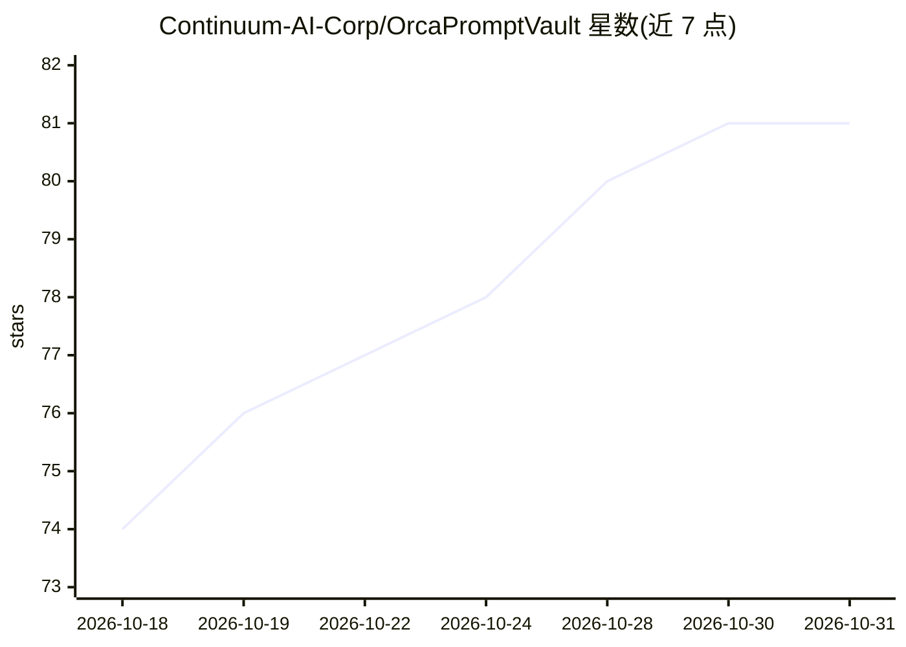

# Continuum-AI-Corp/OrcaPromptVault

⭐ 81 · AGPL-3.0 · 推送 2026-10-01 · [GitHub](https://github.com/Continuum-AI-Corp/OrcaPromptVault) · [官网](https://www.orcarouter.ai) · 组织维护

**AI 产品系统提示词与工具 schema 的开放版本化档案库**

由 OrcaRouter 团队维护的 AI agent 提示词档案库：收录 119 个制品（106 个文件口径见 Credits），覆盖 OpenAI、Anthropic、Google、xAI、Cursor、Moonshot、阿里、DeepSeek、Meta 及 30 余个独立产品（Devin、Windsurf、Cline 等）的系统提示词、开发者指令与工具 schema。分两种来源：通过本地代理抓取并可复现的 captured 文件，与继承自 CL4R1T4S 的 reported 文件。按发布提示词的产品分目录，AGPL-3.0 许可。

## 筛选速览

| 维度 | 判定 | 备注 |
|---|---|---|
| AI 角色 | `ai-knowledge` | 知识聚合/清单类 |
| 许可风险 | `viral` | AGPL-3.0 |
| 部署形态 | `library` | 以包/库形式分发 |
| 模型依赖 | — | README 未给出锁定关系 |
| 硬件要求 | — | 无带数字的原话,不猜 |
| 安装摩擦 | `low` | 无编译、无系统依赖或容器化 |
| 成熟度 | — | 结构信号不足 |

## 能力要点

- 收录 12 家厂商与 30 余独立产品的系统提示词、工具 schema 等 106+ 制品
- 区分 captured（本地代理抓取、可复现）与 reported（模型转述）两种证据等级
- 继承 CL4R1T4S 语料 75 个文件，逐路径索引回上游
- 配套 OrcaReplay 工具可自行抓取新 agent 的提示词并脱敏后提交 PR

## 适用场景

- 研究不同 agent harness 发送的指令与工具表面差异
- 核验某 AI 产品某日期的系统提示词原文并可 diff 追踪变化
- 为互操作性研究查找 coding agent 的工具 schema 定义

## 场景标签

`提示工程` `精选清单` · 领域:Agent 开发

## 证据(README 行号)

> L6: A versioned, verifiable archive of system prompts, developer instructions, tool schemas and agent
> L38: |vendor|products|artifacts|of which captured|

## 星数曲线

2026-10-18 74 → 2026-10-31 81（+7）

---
*卡片 v1 · prompt 1.4 · 生成 2026-10-24 · 置信度 mid · 依据 README sha `d19932e3e4b4` · [字段定义](../../DATASET.md)*
