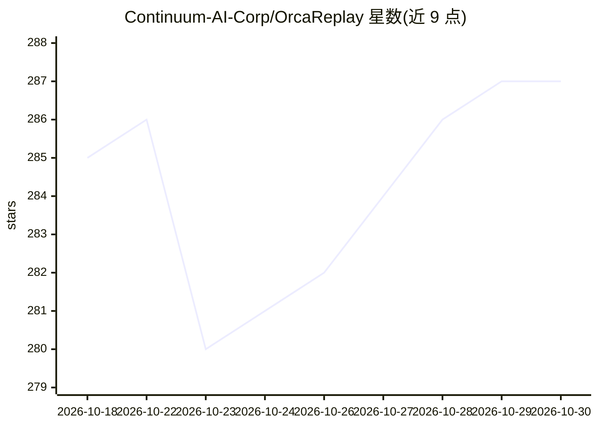

# Continuum-AI-Corp/OrcaReplay

⭐ 287 · TypeScript · Apache-2.0 · 推送 2026-10-01 · [GitHub](https://github.com/Continuum-AI-Corp/OrcaReplay) · [官网](http://www.orcarouter.ai) · 组织维护 · 中文 README

**AI agent 运行录制回放调试工具：离线复现任意 agent 运行**

面向编码 agent 的录制/回放/分叉调试工具。原理是本地代理：通过两个环境变量拦截 agent 与模型 API 间的通信，记录请求、流式响应、工具调用与工具结果，回放时从 trace 逐字节应答、阻断网络，无需调用模型；可在任意 checkpoint 分叉到其他模型并对比验证。另有进程/文件快照层捕获退出码与文件写入，`orca show/graph` 输出事件顺序与因果图，`orca export` 导出 SVG/PNG/GIF 失败链路。不修改 agent 本体，支持 opt-in `--tls-intercept` 录制不可重定向的 agent。以 npm 包 orcareplay 提供，安装后得到 orca 命令。

## 筛选速览

| 维度 | 判定 | 备注 |
|---|---|---|
| AI 角色 | `ai-ecosystem` | LLM/agent 周边工具 |
| 许可风险 | `permissive` | Apache-2.0 |
| 部署形态 | `desktop` | 安装包/桌面程序 |
| 模型依赖 | — | README 未给出锁定关系 |
| 硬件要求 | — | 无带数字的原话,不猜 |
| 安装摩擦 | `low` | 无编译、无系统依赖或容器化 |
| 成熟度 | — | 结构信号不足 |

## 能力要点

- 本地代理 + 两个环境变量录制 agent，无需修改 agent
- 回放从 trace 逐字节应答，不联网、不耗 token
- 任意 checkpoint 分叉到不同模型，`orca compare` 单变量对比并用命令验证
- `orca show/graph` 输出事件时间线与 recorded/inferred 因果图，可导出失败链路图

## 适用场景

- 凌晨跑挂的 agent 运行，早上离线逐字节复现定位
- 在同一 checkpoint 换模型对比谁能做对，评估模型选型
- 捕获并阅读 agent 实际组装的系统提示词
- 把失败因果链导出为图片贴进 issue

## 场景标签

`LLM 可观测性` `模型评测` · 领域:评测与运维

## 证据(README 行号)

> L106: Model APIs are stateless, so on every turn an agent resends the entire conversation — including the
> L110: not patch your agent** — it stands up a local proxy, sets two environment variables, and gets out of
> L37: One npm package named `orcareplay`, which puts one command named `orca` on your PATH. There is no

## 星数曲线

2026-10-18 285 → 2026-10-30 287（+2）

---
*卡片 v1 · prompt 1.4 · 生成 2026-10-22 · 置信度 mid · 依据 README sha `decadaf49d87` · [字段定义](../../DATASET.md)*
