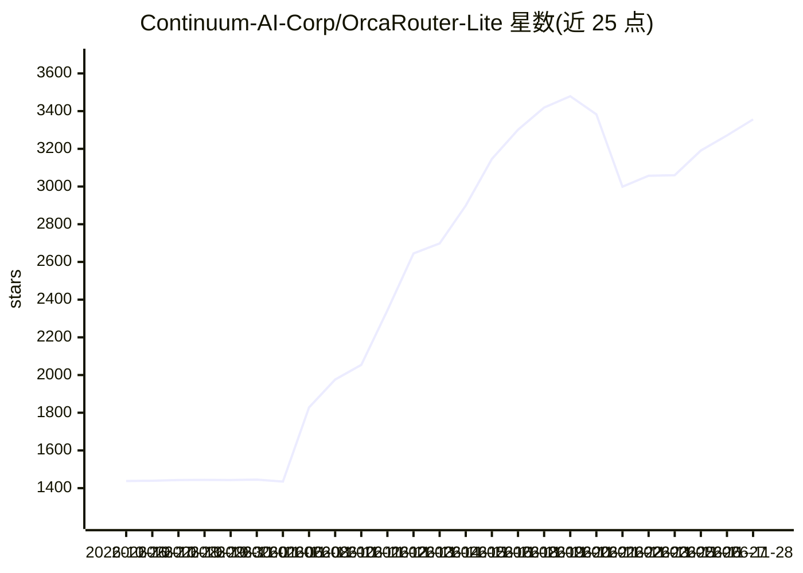

# Continuum-AI-Corp/OrcaRouter-Lite

⭐ 3,356 · Python · MIT · 推送 2026-11-27 · [GitHub](https://github.com/Continuum-AI-Corp/OrcaRouter-Lite) · [官网](https://www.orcarouter.ai) · 组织维护

**给开发者和团队的自托管 LLM 路由网关：按 agent 计费封顶**

OrcaRouter Lite 是开源（MIT）的自托管 LLM 路由网关，同时提供菜单栏桌面应用与服务器两种运行形态。它在本机 127.0.0.1 接收 OpenAI、Anthropic、Gemini 三种协议的请求，路由到用户自配的 provider 密钥（BYOK），支持 model="auto" 按能力要求选最便宜模型、跨 provider 故障转移、SSE 流式、按 agent 独立密钥拆分开销、每日预算告警与暂停。桌面应用携带引擎与本地 SQLite，无需另建服务；托管版 api.orcarouter.ai 可作为兜底上游，组织级功能（SSO/SCIM 等）仅存在于托管付费版。

## 筛选速览

| 维度 | 判定 | 备注 |
|---|---|---|
| AI 角色 | `ai-ecosystem` | LLM/agent 周边工具 |
| 许可风险 | `permissive` | MIT |
| 部署形态 | `desktop` | 安装包/桌面程序 |
| 模型依赖 | — | README 未给出锁定关系 |
| 硬件要求 | — | 无带数字的原话,不猜 |
| 安装摩擦 | `low` | 无编译、无系统依赖或容器化 |
| 成熟度 | `idea` | |

## 能力要点

- 单端口同时支持 OpenAI、Anthropic、Gemini 三种入站协议
- model="auto" 按能力（工具/视觉/JSON mode）自动选最便宜模型，返回 x-orca-resolved-model 头
- 每个 agent 独立密钥，按 agent 拆分开销并支持每日预算告警与暂停
- 模型目录启动时从 LiteLLM 社区定价数据库加载 100+ 模型

## 适用场景

- 为 Claude Code、Codex 等编码 agent 统一设置每日预算与开销看板
- 用自有 provider 密钥在本地或团队服务器自托管 LLM 网关
- provider 失败或限流时自动故障转移到其他 provider 或托管版

## 场景标签

`模型网关` · 领域:Agent 开发

## 证据(README 行号)

> L59: OrcaRouter Lite is the open-source edition of OrcaRouter. It runs on your computer or your server, speaks the OpenA
> L210: Send `model="auto"` and OrcaRouter picks the **cheapest** model in your configured providers that meets the reques
> L142: |**OrcaRouter Lite**|One developer up to a team that wants spend per agent, budgets and failover without new infra

## 星数曲线

2026-10-26 1,438 → 2026-11-28 3,356（+1,918）

---
*卡片 v1 · prompt 1.4 · 生成 2026-11-26 · 置信度 high · 依据 README sha `a2feeef0b4a0` · [字段定义](../../DATASET.md)*
