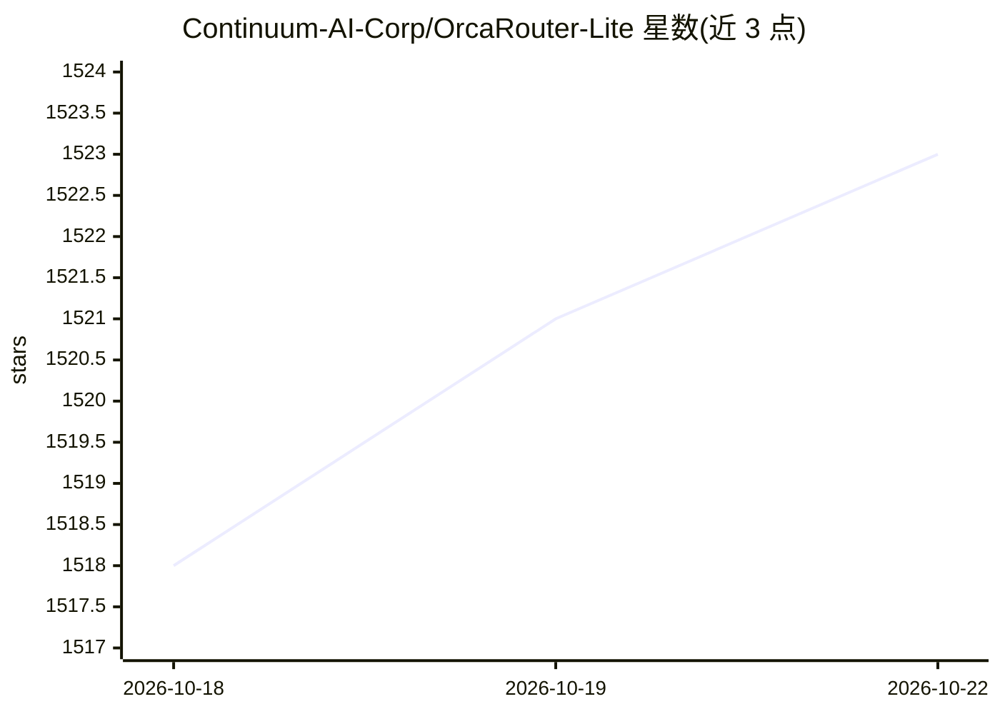

# Continuum-AI-Corp/OrcaRouter-Lite

⭐ 1,523 · Python · MIT · 推送 2026-10-08 · [GitHub](https://github.com/Continuum-AI-Corp/OrcaRouter-Lite) · [官网](https://www.orcarouter.ai) · 组织维护 · 中文 README

**自托管 LLM 路由网关：OpenAI 兼容、多后端、自动选型与故障兜底**

OrcaRouter Lite 是 OrcaRouter 的开源单工作区版本，作为可自托管的服务运行：对外暴露 OpenAI Chat Completions、Anthropic Messages、Gemini 三种入站协议，按用户自带密钥（BYOK）路由到 OpenAI/Anthropic/Google 等提供商；支持 model="auto" 在满足能力要求的前提下选最便宜模型，提供路由策略（balanced/cheapest/fastest/quality）、跨提供商提示缓存、本地分析与单页仪表盘。默认 SQLite、无需 Postgres/Redis，可用作桌面本地服务或经 Docker/Railway/Fly.io 部署；另有需账号的托管版可作为兜底上游。设计上不含多租户、RBAC、计费等能力。

## 筛选速览

| 维度 | 判定 | 备注 |
|---|---|---|
| AI 角色 | `ai-ecosystem` | LLM/agent 周边工具 |
| 许可风险 | `permissive` | MIT |
| 部署形态 | `self-host` | docker 或自建部署 |
| 模型依赖 | — | README 未给出锁定关系 |
| 硬件要求 | — | 无带数字的原话,不猜 |
| 安装摩擦 | `low` | 无编译、无系统依赖或容器化 |
| 成熟度 | — | 结构信号不足 |

## 能力要点

- 三种入站协议（OpenAI/Anthropic/Gemini）共用同一路由管线
- model="auto" 按能力要求选最便宜模型，经响应头回传实际模型
- 跨提供商确定性请求提示缓存（temperature=0 或固定 seed 命中零成本）
- 提供商密钥 AES-256-GCM 加密存储与密钥轮换流程

## 适用场景

- 在自有服务后统一管理多家模型 API 密钥并做成本路由
- Claude Code / Gemini SDK 等客户端直连本地网关使用多个提供商
- 请求在本地记录与分析，不向外发送遥测
- 本地提供商故障时用托管版兜底

## 场景标签

`模型网关` · 领域:Agent 开发

## 证据(README 行号)

> L33: OrcaRouter Lite is the open-source single-workspace edition of OrcaRouter. Run it on your laptop, ship it in your p
> L202: - `POST /v1/chat/completions` — proxy + streaming + `model="auto"` + cross-provider prompt cache

## 星数曲线

2026-10-18 1,518 → 2026-10-22 1,523（+5）

---
*卡片 v1 · prompt 1.4 · 生成 2026-10-21 · 置信度 mid · 依据 README sha `8e3efc4dd91b` · [字段定义](../../DATASET.md)*
