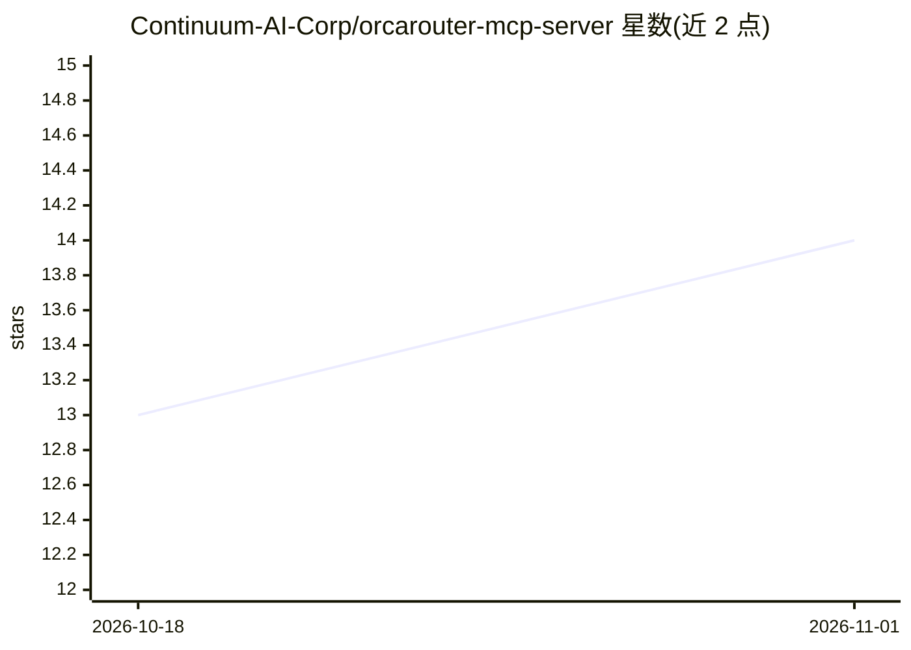

# Continuum-AI-Corp/orcarouter-mcp-server

⭐ 14 · TypeScript · MIT · 推送 2026-10-22 · [GitHub](https://github.com/Continuum-AI-Corp/orcarouter-mcp-server) · [官网](https://www.orcarouter.ai) · 组织维护 · 中文 README

**OrcaRouter LLM 网关的官方 MCP 服务器，可在 MCP 客户端内浏览模型并发起对话**

由 Continuum-AI-Corp 维护的 OrcaRouter LLM 网关官方 MCP 服务器：向 Claude Desktop、Claude Code、Cursor、Windsurf、Zed 等 MCP 客户端暴露 4 个工具——对话补全（可配回退链）、模型目录浏览（定价/上下文/能力）、单模型详情卡、提供商列表。目录浏览无需 API key；对话补全需 ORCAROUTER_API_KEY。支持通过 orcarouter/auto 路由器按 cost/quality/balanced/LinUCB/gated-adaptive 策略自动路由，主模型后可接最多 4 个回退模型。以 npm 包经 npx 运行，需 Node.js 18+。

## 筛选速览

| 维度 | 判定 | 备注 |
|---|---|---|
| AI 角色 | `ai-ecosystem` | LLM/agent 周边工具 |
| 许可风险 | `permissive` | MIT |
| 部署形态 | `library` | 以包/库形式分发 |
| 模型依赖 | — | README 未给出锁定关系 |
| 硬件要求 | — | 无带数字的原话,不猜 |
| 安装摩擦 | `low` | 无编译、无系统依赖或容器化 |
| 成熟度 | — | 结构信号不足 |

## 能力要点

- 无 API key 即可浏览提供商、模型目录与定价对比
- 对话补全支持最多 4 层回退链与 5 种自动路由策略
- 提供 4 个 MCP 工具：chat/models_list/model_card/providers_list
- 附 Claude Desktop/Claude Code/Cursor/Windsurf 配置示例

## 适用场景

- 在 Claude Desktop 或 Cursor 中直接浏览和对比各模型定价与能力
- 通过 MCP 客户端调用 OrcaRouter 上的模型做对话补全
- 为对话请求配置回退链以增强可用性

## 场景标签

`模型网关` · 领域:Agent 开发

## 证据(README 行号)

> L7:  Official MCP server for the OrcaRouter LLM gateway.
> L17: Browse OrcaRouter's model catalog and run chat

## 星数曲线

2026-10-18 13 → 2026-11-01 14（+1）

---
*卡片 v1 · prompt 1.4 · 生成 2026-10-31 · 置信度 high · 依据 README sha `56555e1dfc6b` · [字段定义](../../DATASET.md)*
