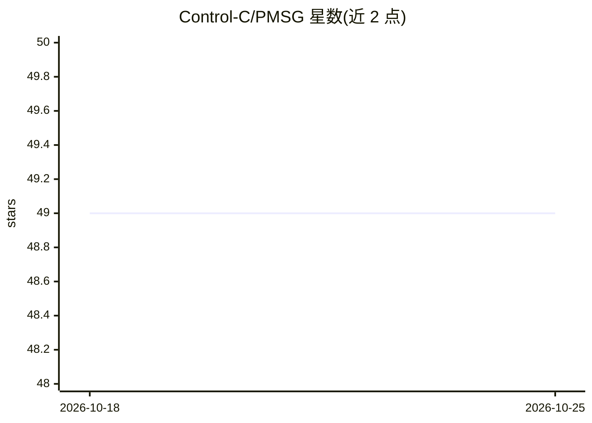

# Control-C/PMSG

⭐ 49 · C++ · 推送 2026-10-03 · [GitHub](https://github.com/Control-C/PMSG) · [官网](https://pmsg.online/) · 个人维护

**DIY 智能眼镜开源硬件项目：基于 XIAO 的镜腿 PCBA 与固件**

面向 DIY 硬件爱好者的可穿戴智能眼镜项目：提供基于 Seeed Studio XIAO（ESP32-C3）的定制镜腿 PCBA 设计与可烧录固件代码，替换普通眼镜镜腿，接入 Grove 传感器（光照、温湿度、OLED、摄像头等），支持 WiFi/BLE，可经 USB-C OTG 连接手机。README 提供指向 ChatGPT/Gemini/Grok 等的预配置提示词链接辅助搭建。PCB 设计自标为未测试草稿，软件部分标注 TODO/WIP，无完整软件文档。

## 筛选速览

| 维度 | 判定 | 备注 |
|---|---|---|
| AI 角色 | `ai-enhanced` | 去掉 AI 部分产品仍成立 |
| 许可风险 | `none` | — |
| 部署形态 | `None` |  |
| 模型依赖 | — | README 未给出锁定关系 |
| 硬件要求 | — | 无带数字的原话,不猜 |
| 安装摩擦 | `low` | 无编译、无系统依赖或容器化 |
| 成熟度 | `idea` | |

## 能力要点

- 基于 XIAO ESP32-C3 的镜腿 PCBA 设计（含铰链切口）
- Grove 接口扩展 I2C/UART/GPIO 传感器
- WiFi/BLE 可关闭，支持 USB-C OTG 连接（Android 已测试）
- 提供 ChatGPT/Gemini/Grok 预配置提示词辅助搭建

## 适用场景

- 把旧眼镜改造成带传感器的 DIY 智能眼镜
- 学习 ESP32 嵌入式开发与 Grove 模块组装
- 通过 AI 助手引导完成硬件选型与接线

## 场景标签

 · 领域:硬件/可穿戴设备

## 证据(README 行号)

> L88: Ever looked at your old sunglasses and thought, *“These could use a little IoT love?”* Well, now they can! The PMSG
> L148: - MCU - Esp32C3 *( possible to use the WIFI and BLE please add external antenna its compatible XIAO 2.4Hgz also on

## 星数曲线

2026-10-18 49 → 2026-10-25 49（+0）

---
*卡片 v1 · prompt 1.4 · 生成 2026-10-25 · 置信度 high · 依据 README sha `b007e43633b0` · [字段定义](../../DATASET.md)*
