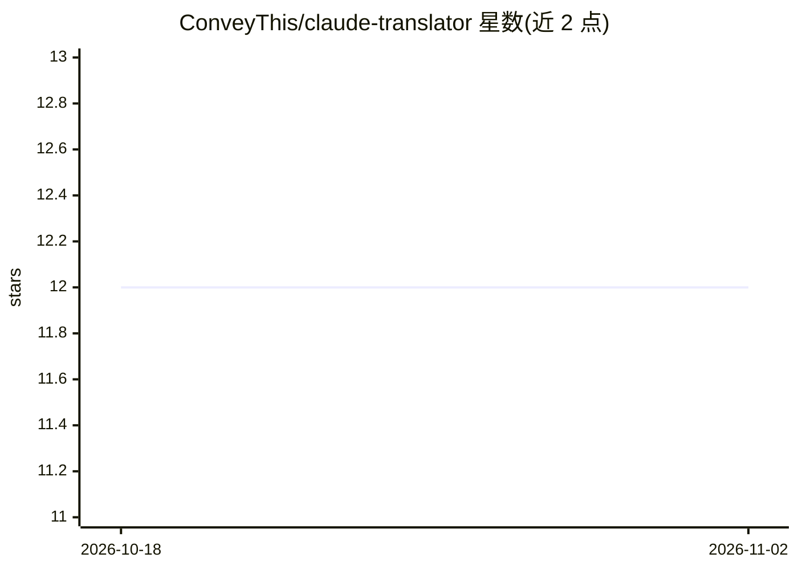

# ConveyThis/claude-translator

⭐ 12 · JavaScript · AGPL-3.0 · 推送 2026-08-30 · [GitHub](https://github.com/ConveyThis/claude-translator) · [官网](https://www.conveythis.com/open-source/claude-translator?utm_source=github&utm_medium=repo-homepage&utm_campaign=claude-translator) · 组织维护

**静态站点多语言本地化管线：AI 翻译已构建的 HTML**

面向静态站点的本地化工具：指向已构建的站点目录与语言列表，调用 Claude（默认）、Gemini、OpenAI 兼容端点或本地模型，将翻译按字节偏移拼接进已构建的 HTML 而非重新渲染，同时改写 hreflang、canonical、dir="rtl" 与各语言 JSON-LD，并以八道校验门与 SEO 审计核验结果。支持术语表保护品牌词、按 locale 的数字/货币格式化。需 Node.js ≥ 20 与模型 API key（本地模型可免 key）。由 ConveyThis 公司维护，采用 AGPL-3.0。限制：适用于发布节奏更新的静态站，不适合 CMS/电商等运行时编辑场景。

## 筛选速览

| 维度 | 判定 | 备注 |
|---|---|---|
| AI 角色 | `ai-native` | 本体是模型或模型工具 |
| 许可风险 | `viral` | AGPL-3.0 |
| 部署形态 | `library` | 以包/库形式分发 |
| 模型依赖 | local-ok | 支持本地模型 |
| 硬件要求 | — | 无带数字的原话,不猜 |
| 安装摩擦 | `low` | 无编译、无系统依赖或容器化 |
| 成熟度 | — | 结构信号不足 |

## 能力要点

- 按字节偏移拼接翻译到已构建 HTML，不重新渲染，保持 Core Web Vitals 指标不变
- 以文本块（含占位符的 inline 标签）为翻译单位，避免拆分导致的语法破损
- 术语表区分大小写地保护品牌名，并支持按语言固定译法
- 八道校验门与全页面 SEO 审计（hreflang mesh、sitemap、canonical）

## 适用场景

- 把 Hugo/Astro/Eleventy 等构建出的静态站点生成数十种语言的真实静态页面
- 在不重新渲染、不破坏关键 CSS 的前提下做多语言 SEO（hreflang/JSON-LD 修正）
- 用自己的模型 API key 或本地模型自托管地完成站点翻译

## 场景标签

 · 领域:Web 开发/本地化工具

## 证据(README 行号)

> L10: Point it at a built site, give it a list of locales and your own model API key, and it
> L113: - **An API key for whichever model you want to use** — Claude by default

## 星数曲线

2026-10-18 12 → 2026-11-02 12（+0）

---
*卡片 v1 · prompt 1.4 · 生成 2026-11-01 · 置信度 high · 依据 README sha `fd47d0d6b3ab` · [字段定义](../../DATASET.md)*
