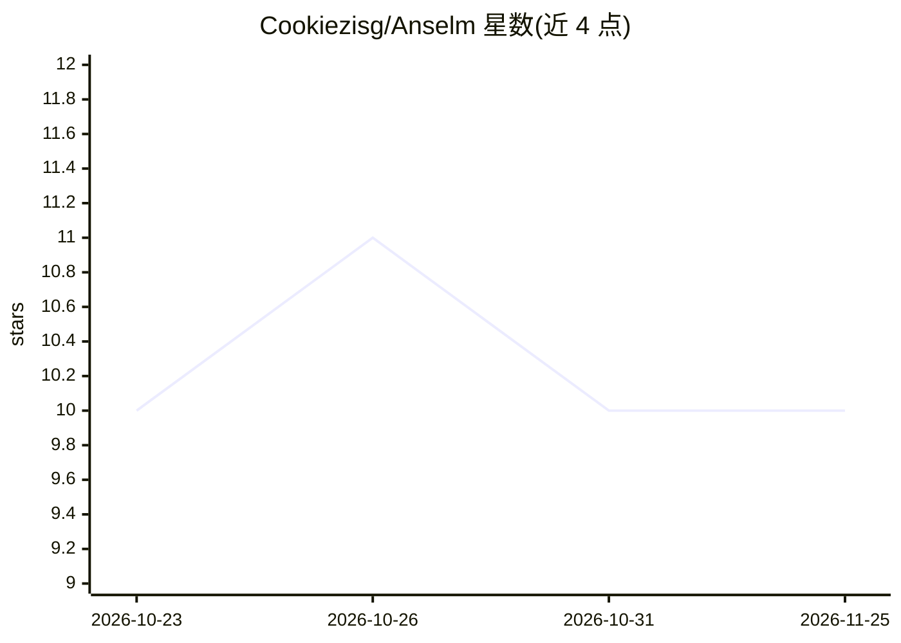

# Cookiezisg/Anselm

⭐ 10 · Go · Apache-2.0 · 推送 2026-11-17 · [GitHub](https://github.com/Cookiezisg/Anselm) · [官网](https://anselm.website) · 个人维护 · 中文 README

**本地优先的桌面 Agent 工作流平台：对话生成并持久运行工作流**

Flutter 桌面应用 + Go sidecar + SQLite 的本地运行时：用户用自然语言描述目标，平台自动创建 Function、Handler、Agent 与 Workflow 实体并组成图，经 cron/webhook/文件变更触发器调度，节点结果写入 SQLite 实现崩溃恢复与幂等重走。支持审批节点的人工介入、运行矩阵/Gantt/活动日志观察，Agent 可挂载工具与 MCP 目录。管理模型路由免配置即用，也可接 Ollama 或 OpenAI/Anthropic 兼容端点或自带 key。单用户、本机运行，多用户/托管部署尚未提供。

## 筛选速览

| 维度 | 判定 | 备注 |
|---|---|---|
| AI 角色 | `ai-native` | 本体是模型或模型工具 |
| 许可风险 | `permissive` | Apache-2.0 |
| 部署形态 | `desktop` | 安装包/桌面程序 |
| 模型依赖 | local-ok | 支持本地模型 |
| 硬件要求 | — | 无带数字的原话,不猜 |
| 安装摩擦 | `low` | 无编译、无系统依赖或容器化 |
| 成熟度 | `idea` | |

## 能力要点

- 自然语言生成四类可执行实体并编排为工作流图
- SQLite 持久化的 durable execution：崩溃后只补跑未完成节点
- 审批节点人工介入、超时策略、通知台账
- 支持 MCP 目录、FTS5 检索、多模态输入与图像/语音/视频生成

## 适用场景

- 用一句话搭建每周定时采集 GitHub 动态并生成摘要的工作流
- 在本地机器上持久运行带审批环节的自动化流程
- 通过 MCP 与工具挂载让 Agent 执行多步骤任务
- 中文/英文界面下管理本地文档、技能与运行历史

## 场景标签

`工作流自动化` · 领域:效率与自动化

## 证据(README 行号)

> L5:  The agentic workflow platform that builds itself.
> L31: - **The AI builds the workflow.** Ask for an outcome in chat. Anselm plans the work, creates each building block as
> L35: - **Local-first.** One desktop app, one Go sidecar, one SQLite file. Your workflows, run history, documents, and ke

## 星数曲线

2026-10-23 10 → 2026-11-25 10（+0）

---
*卡片 v1 · prompt 1.4 · 生成 2026-11-20 · 置信度 high · 依据 README sha `bfa1e92f5a08` · [字段定义](../../DATASET.md)*
