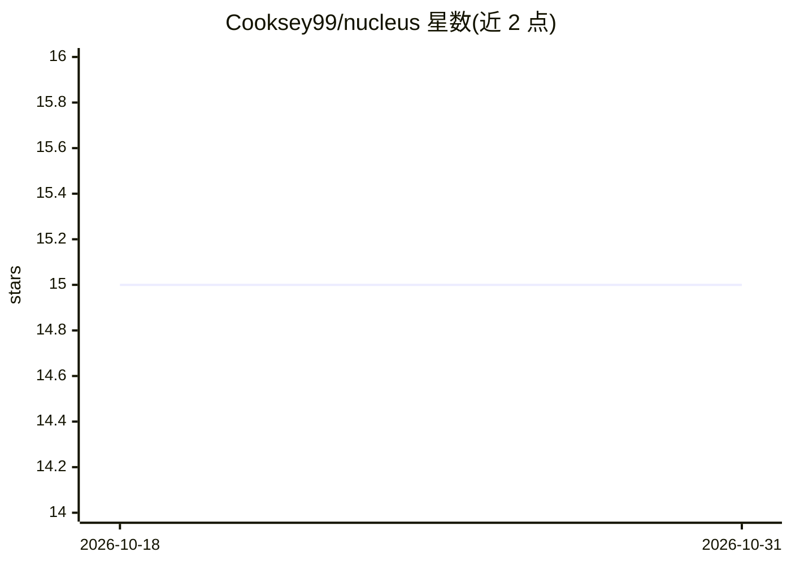

# Cooksey99/nucleus

⭐ 15 · Rust · MIT · 推送 2026-10-27 · [GitHub](https://github.com/Cooksey99/nucleus) · 个人维护

**Rust 库：为开发者构建本地 LLM 驱动的工具基础设施**

面向开发者的模块化 Rust library（非应用），提供接入本地或自托管 LLM 的基础设施：工具增强的 LLM 编排（读文件、搜索代码、执行命令）、带权限控制的插件系统，以及用于私有文档的内置 RAG（向量数据库持久存储、自动去重、快速向量搜索）。仅连接本地/自托管 LLM 后端，声明无遥测。以 Cargo workspace 组织为 core/plugin/std/dev 四个 crate，API 处于活跃开发期、尚不稳定（0.1，非 1.0）。

## 筛选速览

| 维度 | 判定 | 备注 |
|---|---|---|
| AI 角色 | `ai-ecosystem` | LLM/agent 周边工具 |
| 许可风险 | `permissive` | MIT |
| 部署形态 | `None` |  |
| 模型依赖 | local-ok | 支持本地模型 |
| 硬件要求 | — | 无带数字的原话,不猜 |
| 安装摩擦 | `medium` | 含编译或系统依赖之一 |
| 成熟度 | `idea` | |

## 能力要点

- 工具增强 LLM：通过插件执行读文件/搜索/执行命令等实际操作
- 插件系统带权限控制，含 git、LSP 集成的开发插件
- 内置 RAG 向量存储：持久化、去重、快速向量搜索
- 仅连接本地/自托管 LLM，声明无遥测与分析数据

## 适用场景

- 构建 AI 增强的终端包装器或代码审查助手
- 为项目搭建能读写文件、理解代码库的本地 AI 助手
- 对私有文档做本地 RAG 检索而不外传数据

## 场景标签

`Agent 框架` `RAG` · 领域:Agent 开发

## 证据(README 行号)

> L9: Nucleus is a **library**, not an application. It provides the building blocks for creating AI-powered developer tool
> L13: - **Local-First**: Works with local LLMs (Ollama, llama.cpp, etc.) - no data leaves your machine
> L51: - **nucleus-core**: LLM orchestration, chat management, configuration

## 星数曲线

2026-10-18 15 → 2026-10-31 15（+0）

---
*卡片 v1 · prompt 1.4 · 生成 2026-10-31 · 置信度 high · 依据 README sha `68d763d5b026` · [字段定义](../../DATASET.md)*
