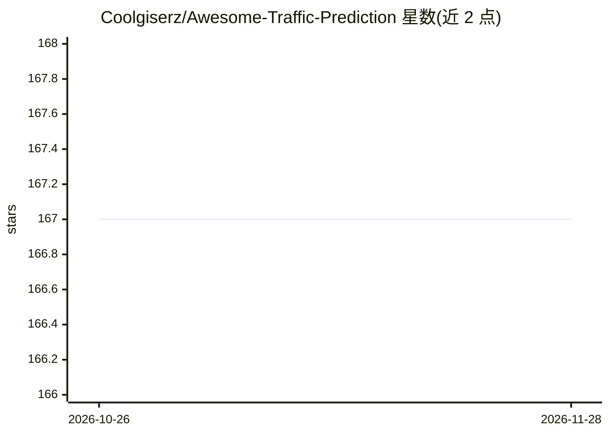

# Coolgiserz/Awesome-Traffic-Prediction

⭐ 167 · Python · 推送 2026-11-24 · [GitHub](https://github.com/Coolgiserz/Awesome-Traffic-Prediction) · [官网](https://coolgiserz.github.io/Awesome-Traffic-Prediction/) · 个人维护 · 中文 README

**交通预测研究者用的论文/数据集/教程资源清单**

收录交通预测领域资源的 Awesome 清单：按年份组织深度学习方法论文（含综述、官方/社区代码与数据集链接），另设 Reviews、Datasets、Tutorials、Toolkits 等板块。提供中文版 README，并每月生成论文标题词云、Top-K 词频与年度热点趋势图，用于跟踪领域研究热度。面向从事交通/时空预测研究的用户。

## 筛选速览

| 维度 | 判定 | 备注 |
|---|---|---|
| AI 角色 | `ai-knowledge` | 知识聚合/清单类 |
| 许可风险 | `none` | — |
| 部署形态 | `None` |  |
| 模型依赖 | — | README 未给出锁定关系 |
| 硬件要求 | — | 无带数字的原话,不猜 |
| 安装摩擦 | `low` | 无编译、无系统依赖或容器化 |
| 成熟度 | — | 结构信号不足 |

## 能力要点

- 按年份梳理 2015 起的深度学习交通预测论文并附论文/代码链接
- 含综述专节与数据集、教程、工具包板块
- 每月更新论文词云、Top-K 词频与年度热点趋势图
- 提供中文版 README

## 适用场景

- 查找交通流量/速度预测方向的经典与最新论文
- 为时空图神经网络研究寻找代码与数据集
- 跟踪交通预测领域的研究热点趋势

## 场景标签

`精选清单` · 领域:学习与行业

## 证据(README 行号)

> L8: This repository contains useful resources for traffic prediction, including popular papers, datasets, tutorials, too
> L41: ### Deep Learning Based Traffic Prediction Methods

## 星数曲线

2026-10-26 167 → 2026-11-28 167（+0）

---
*卡片 v1 · prompt 1.4 · 生成 2026-11-27 · 置信度 high · 依据 README sha `99c0f6c44184` · [字段定义](../../DATASET.md)*
