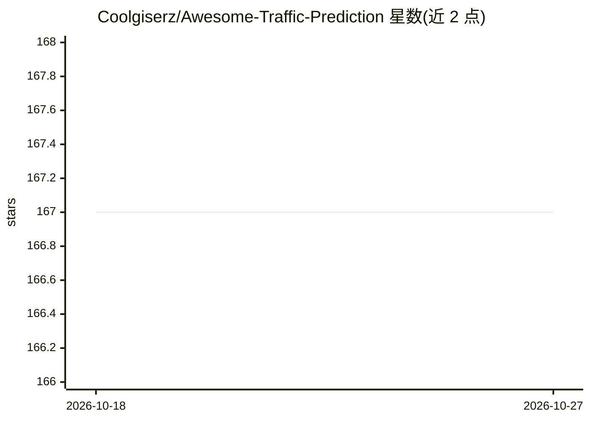

# Coolgiserz/Awesome-Traffic-Prediction

⭐ 167 · Python · 推送 2026-10-16 · [GitHub](https://github.com/Coolgiserz/Awesome-Traffic-Prediction) · 个人维护 · 中文 README

**交通预测研究资源清单：论文、数据集、教程与工具汇总**

面向交通预测研究者的资源聚合仓库，按年份（2015 起）与主题（综述、深度学习方法等）组织论文条目，每条附论文链接、代码链接（官方/非官方/PyTorch 版）、数据集与评审链接；另包含数据集、教程、工具包和其他仓库章节，并展示月度词云、Top 术语与年度热点趋势等可视化。提供中文版 README。仅收录条目，不含可运行代码。

## 筛选速览

| 维度 | 判定 | 备注 |
|---|---|---|
| AI 角色 | `ai-knowledge` | 知识聚合/清单类 |
| 许可风险 | `none` | — |
| 部署形态 | `None` |  |
| 模型依赖 | — | README 未给出锁定关系 |
| 硬件要求 | — | 无带数字的原话,不猜 |
| 安装摩擦 | `low` | 无编译、无系统依赖或容器化 |
| 成熟度 | — | 结构信号不足 |

## 能力要点

- 按年份与主题组织的交通预测论文清单，附论文/代码/数据/评审链接
- 区分官方代码、非官方代码与 PyTorch 复现版本
- 月度词云、Top 术语频率与年度热点趋势可视化
- 提供中文版 README（README.zh.md）

## 适用场景

- 查找交通预测领域的综述与代表性论文
- 为复现实验寻找对应模型的开源代码与数据集
- 了解交通预测研究的年度热点变化

## 场景标签

`精选清单` · 领域:学习与行业

## 证据(README 行号)

> L8: This repository contains useful resources for traffic prediction, including popular papers, datasets, tutorials, too
> L30: ## 0x00 Papers

## 星数曲线

2026-10-18 167 → 2026-10-27 167（+0）

---
*卡片 v1 · prompt 1.4 · 生成 2026-10-22 · 置信度 high · 依据 README sha `132e5f015f23` · [字段定义](../../DATASET.md)*
