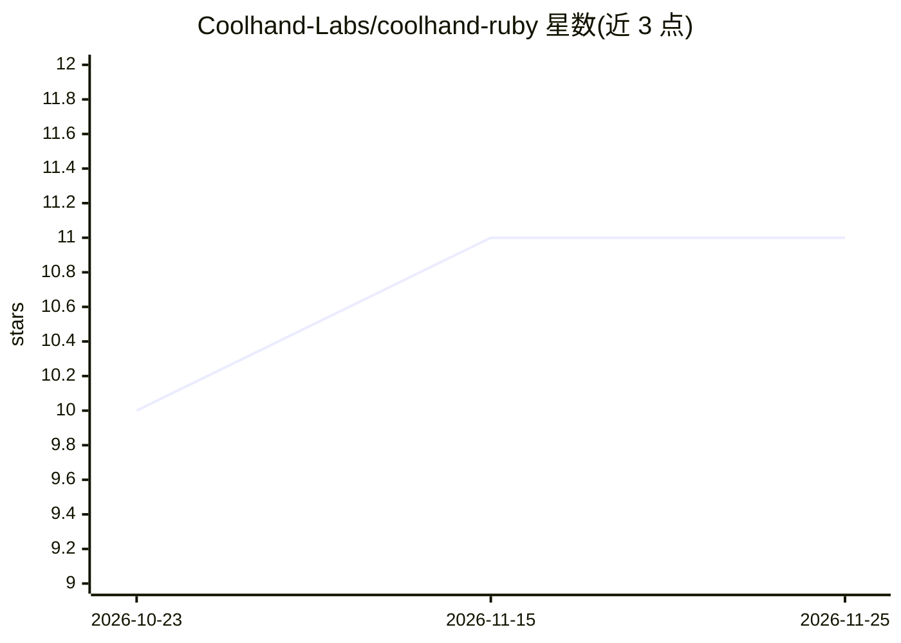

# Coolhand-Labs/coolhand-ruby

⭐ 11 · Ruby · Apache-2.0 · 推送 2026-11-24 · [GitHub](https://github.com/Coolhand-Labs/coolhand-ruby) · [官网](https://coolhandlabs.com) · 组织维护

**为 Ruby 应用自动记录并分析 LLM API 调用的监控 SDK**

Coolhand 的 Ruby SDK，通过拦截应用发出的 LLM API HTTP 请求（OpenAI、Anthropic、Google Gemini、Cohere 及任何基于 Faraday/Net::HTTP 的客户端），自动将请求与响应日志发送到 Coolhand 分析平台，并提供反馈收集 API、成本与性能指标查询、workload/template 声明、webhook 转发等功能。支持 Rails initializer 配置与后台线程异步上报，可指向自托管端点。需要 Coolhand 平台账号与 API key。

## 筛选速览

| 维度 | 判定 | 备注 |
|---|---|---|
| AI 角色 | `ai-ecosystem` | LLM/agent 周边工具 |
| 许可风险 | `permissive` | Apache-2.0 |
| 部署形态 | `None` |  |
| 模型依赖 | locked-api |  |
| 硬件要求 | — | 无带数字的原话,不猜 |
| 安装摩擦 | `low` | 无编译、无系统依赖或容器化 |
| 成熟度 | — | 结构信号不足 |

## 能力要点

- 零改动拦截 Net::HTTP/Faraday 发出的 LLM API 调用并自动上报
- Feedback API 收集用户对 LLM 响应的反馈并关联到优化项
- 按 workload/template 查询成本、性能与失败归因指标
- 支持自托管端点、凭据脱敏与异步日志

## 适用场景

- 监控生产环境中 Ruby/Rails 应用的 LLM 调用成本
- 收集用户反馈以分析模型回答质量
- 按业务模块（workload/template）归因 LLM 用量与失败

## 场景标签

`LLM 可观测性` · 领域:评测与运维

## 证据(README 行号)

> L5: Monitor and log LLM API calls — OpenAI, Anthropic, Google Gemini, Cohere, and any Faraday-based or Net::HTTP client 
> L9: ## Installation
> L43: ## Self-Hosted Deployments

## 星数曲线

2026-10-23 10 → 2026-11-25 11（+1）

---
*卡片 v1 · prompt 1.4 · 生成 2026-11-19 · 置信度 high · 依据 README sha `937a957bd910` · [字段定义](../../DATASET.md)*
