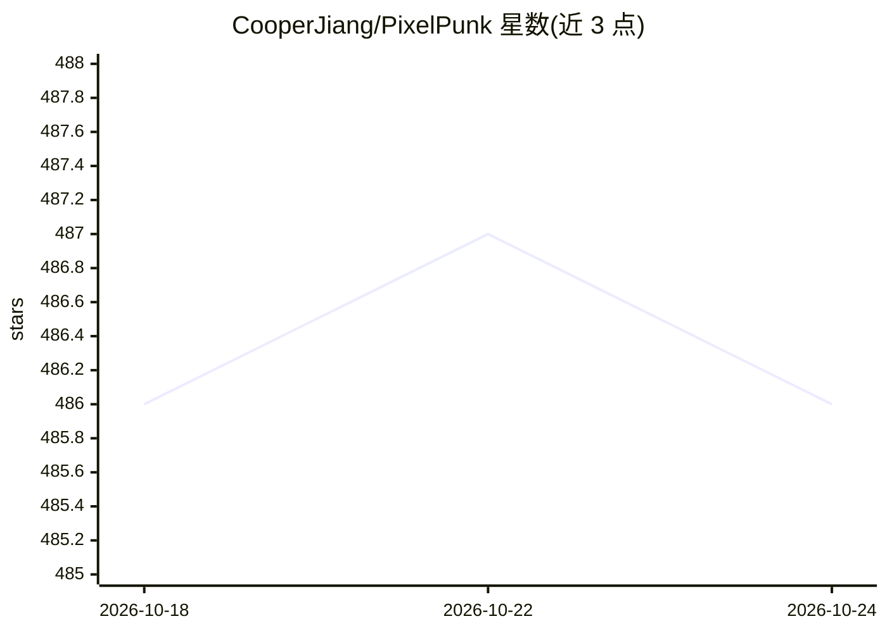

# CooperJiang/PixelPunk

⭐ 486 · Vue · NOASSERTION · 推送 2025-11-19 · [GitHub](https://github.com/CooperJiang/PixelPunk) · [官网](https://pixelpunk.cc) · 个人维护 · 中文 README

**带 AI 智能标签与审核的自托管图床/资源管理平台**

Go + Vue 3 构建的全栈图床与文件管理平台，面向个人与团队自部署。核心功能包括 10+ 格式上传、无限嵌套文件夹、标签分类、批量操作、自然语言搜索、文件夹/图片分享（密码与过期）、防盗链与 IP/域名黑白名单、流量带宽控制、多主题与中日英界面。AI 部分为可选功能：基于 OpenAI 兼容 API 的自动分类、打标、语义解析与 NSFW 检测，配合 Qdrant 向量库实现以图搜图与语义相似搜索。提供单文件二进制、一键脚本与 Docker 部署；采用 PolyForm Noncommercial 许可，商用需授权。

## 筛选速览

| 维度 | 判定 | 备注 |
|---|---|---|
| AI 角色 | `ai-enhanced` | 去掉 AI 部分产品仍成立 |
| 许可风险 | `none` | NOASSERTION |
| 部署形态 | `self-host` | docker 或自建部署 |
| 模型依赖 | — | README 未给出锁定关系 |
| 硬件要求 | — | 无带数字的原话,不猜 |
| 安装摩擦 | `low` | 无编译、无系统依赖或容器化 |
| 成熟度 | — | 结构信号不足 |

## 能力要点

- OpenAI 兼容 API 实现自动分类、打标、语义解析与 NSFW 检测
- Qdrant 向量库支持以图搜图与语义相似搜索
- 单二进制文件、一键脚本与 Docker 三种部署方式
- 多主题（含赛博朋克）、中日英多语言、可视化后台与操作日志审计

## 适用场景

- 搭建个人或团队的自托管图床与文件分享站
- 利用 AI 自动为图片打标签、分类并过滤不当内容
- 通过语义搜索与以图搜图快速定位图片资源

## 场景标签

`语义搜索` · 领域:知识与检索

## 证据(README 行号)

> L5: **Full-Stack Intelligent Image Hosting & Resource Management Platform**
> L163: - **Vector Database**: Qdrant 1.11+ (optional, for AI search)
> L164: - **AI Service**: OpenAI API or compatible (optional, for AI features)

## 星数曲线

2026-10-18 486 → 2026-10-24 486（+0）

---
*卡片 v1 · prompt 1.4 · 生成 2026-10-21 · 置信度 high · 依据 README sha `ade99ace3b66` · [字段定义](../../DATASET.md)*
