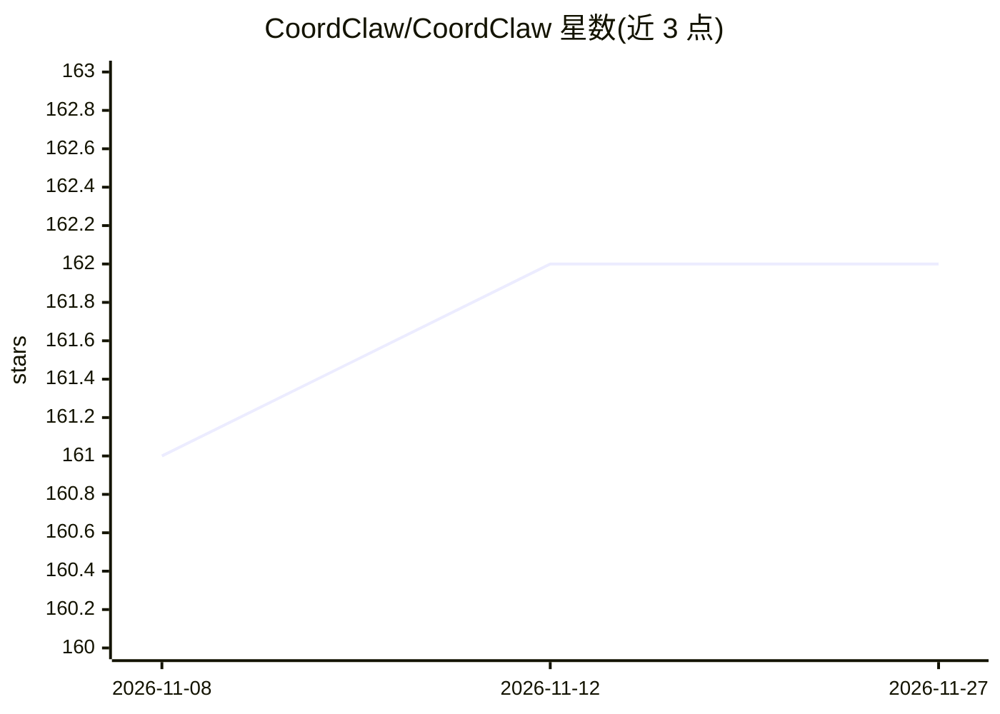

# CoordClaw/CoordClaw

⭐ 162 · TypeScript · MIT · 推送 2026-08-23 · [GitHub](https://github.com/CoordClaw/CoordClaw) · 组织维护 · 中文 README

**多智能体协作系统：用自然语言定义 AI 团队模拟一人公司**

CoordClaw 是运行于 OpenClaw 运行时之上的多智能体协作系统：团队结构与协作规则以自然语言 MD 文档定义（team RULE.md / teamsoul.md），Agent 间通过点对点消息循环（T1~T5 标准动作）自行开会、裁决与交付，而非硬编码 DAG 编排。每轮上下文完全重置，以结构化工作日志作为项目记忆防止上下文污染；人类以上帝视角观察全部消息并可扮演任意成员干预。提供控制面板、安装向导、预置 7 人团队模板、AI 引导式创建团队与 25 个运行时参数（team.json）。依赖 Node.js>=22 与 OpenClaw（或变体 qclaw），仅 Windows 完整测试，Linux/macOS 未实测。

## 筛选速览

| 维度 | 判定 | 备注 |
|---|---|---|
| AI 角色 | `ai-ecosystem` | LLM/agent 周边工具 |
| 许可风险 | `permissive` | MIT |
| 部署形态 | `None` |  |
| 模型依赖 | — | README 未给出锁定关系 |
| 硬件要求 | — | 无带数字的原话,不猜 |
| 安装摩擦 | `low` | 无编译、无系统依赖或容器化 |
| 成熟度 | `idea` | |

## 能力要点

- 自然语言 MD 文档定义团队结构，非代码编排流程
- 每轮上下文重置 + 结构化工作日志外化记忆
- 人类上帝视角观察/干预，Agent 受限点对点消息
- token 消耗本地 BPE 估算，覆盖不返回 usage 的端点

## 适用场景

- 让多个 Agent 组成团队自主完成软件开发等生产任务
- 研究/观察 AI 组织的经济、社会与管理行为
- 自定义组织结构与协作规则做管理学实验

## 场景标签

`多智能体` · 领域:Agent 开发

## 证据(README 行号)

> L35: CoordClaw多智能体系统不是用代码来定义流程，而是根据用自然语言编写的组织关系来组建团队完成任务。
> L132: > CoordClaw 依赖 OpenClaw（或其变体，如 qclaw）提供的运行时，且需要该运行时**已完成环境初始化**才能被发现。
> L270: - **T1** — 用 `chat_manager.py inbox` 拉取未读消息

## 星数曲线

2026-11-08 161 → 2026-11-27 162（+1）

---
*卡片 v1 · prompt 1.4 · 生成 2026-11-17 · 置信度 high · 依据 README sha `890d8f5cef52` · [字段定义](../../DATASET.md)*
