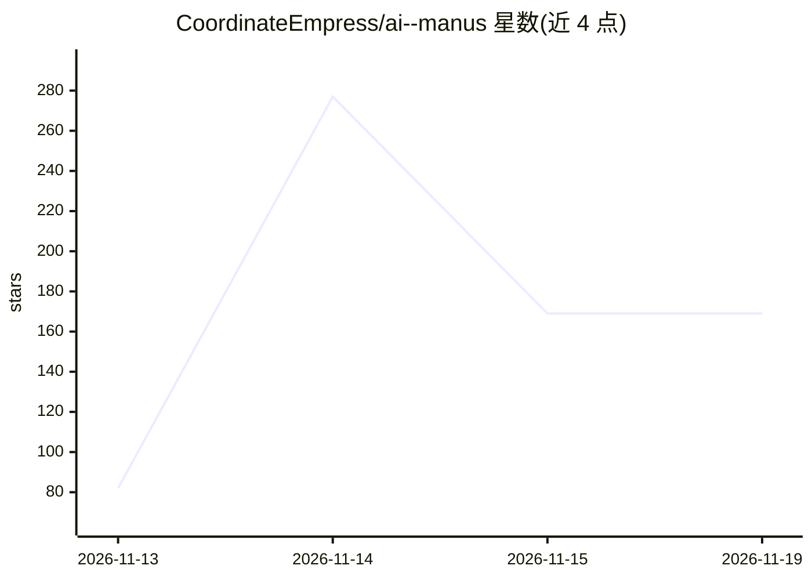

# CoordinateEmpress/ai--manus

⭐ 169 · Apache-2.0 · 推送 2026-11-15 · [GitHub](https://github.com/CoordinateEmpress/ai--manus) · 个人维护

**自主运行代码与控制浏览器的通用 AI Agent 助手**

Manus 是面向个人用户的自主 AI Agent：接收自然语言指令后代为编写并执行脚本、打开网页、填写表单、与页面元素交互，完成多步骤任务，且可跨会话复用已学到的任务模式。定位为家庭、学习与轻量办公场景的后台个人助手，非企业平台。README 给出硬件兼容表（最低 4 GB 内存、双核 CPU）与六步上手流程，但未提供任何安装命令、依赖说明或源码结构信息，仅有下载提及与推广码。

## 筛选速览

| 维度 | 判定 | 备注 |
|---|---|---|
| AI 角色 | `ai-native` | 本体是模型或模型工具 |
| 许可风险 | `permissive` | Apache-2.0 |
| 部署形态 | `None` |  |
| 模型依赖 | — | README 未给出锁定关系 |
| 硬件要求 | — | 无带数字的原话,不猜 |
| 安装摩擦 | `low` | 无编译、无系统依赖或容器化 |
| 成熟度 | — | 结构信号不足 |

## 能力要点

- 自主编写并执行代码完成任务
- 浏览器控制：导航、填表、抓取信息
- 脚本与浏览器操作可在同一任务流中衔接
- 面向轻量场景的后台个人助手模式

## 适用场景

- 让 Agent 代为完成查网页、填表单等重复性操作
- 学习研究中整理资料、运行小脚本
- 小型项目中把重复步骤委托给后台助手

## 场景标签

`AI 助手` `浏览器自动化` `编码 Agent` · 领域:效率与自动化

## 证据(README 行号)

> L10: - **Autonomous Code Execution:** Manus AI agent runs code on its own to complete tasks, so you can focus on decisio
> L18: Manus is an autonomous AI agent designed to run code and control a browser on your behalf. Instead of acting like a

## 星数曲线

2026-11-13 82 → 2026-11-19 169（+87）

---
*卡片 v1 · prompt 1.4 · 生成 2026-11-17 · 置信度 mid · 依据 README sha `0f78ee3a5dd2` · [字段定义](../../DATASET.md)*
