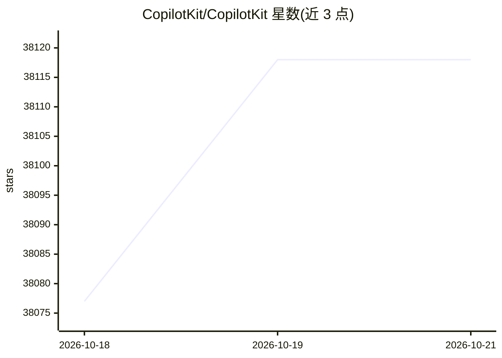

# CopilotKit/CopilotKit

⭐ 38,118 · TypeScript · MIT · 推送 2026-10-19 · [GitHub](https://github.com/CopilotKit/CopilotKit) · [官网](https://docs.copilotkit.ai) · 组织维护

**给开发者提供 agent 前端接入栈与 Generative UI**

面向构建 agent 应用的前端 SDK：将聊天 UI、Generative UI、共享状态与 human-in-the-loop 工作流接入 React、Angular、Vue、React Native 等框架，并通过 Channels SDK 将同一 agent 发布到 Slack、Microsoft Teams、Discord、WhatsApp、Telegram 等渠道。底层的 agent 前端通信由其维护的 AG-UI Protocol 承担，提供 useAgent hook 编程式控制 agent 连接。安装走 npm/npx 脚手架命令，另有可选的 CopilotKit Intelligence 托管或自托管平台（持久会话、用户记忆、分析）。MIT 许可。

## 筛选速览

| 维度 | 判定 | 备注 |
|---|---|---|
| AI 角色 | `ai-native` | 本体是模型或模型工具 |
| 许可风险 | `permissive` | MIT |
| 部署形态 | `library` | 以包/库形式分发 |
| 模型依赖 | — | README 未给出锁定关系 |
| 硬件要求 | — | 无带数字的原话,不猜 |
| 安装摩擦 | `low` | 无编译、无系统依赖或容器化 |
| 成熟度 | — | 结构信号不足 |

## 动量与使用信号

- 维护:`active` — 距上次 push 0.7 天,年发版 100,232 位贡献者
- 涨星:近 1 天 **+24**(自 20261016 起算)
- 下载:GitHub Release 附件 累计 397(100 个 release)
- 平台:WEB · 协议:MCP

## 能力要点

- 支持 React/Angular/Vue/React Native 前端框架接入
- 提供 Generative UI、共享状态与 human-in-the-loop 机制
- Channels SDK 支持发布到 Slack/Teams/Discord/WhatsApp/Telegram
- 维护 AG-UI Protocol 并提供 useAgent hook

## 适用场景

- 为现有 agent 搭建 Web 或移动端聊天与生成式界面
- 把同一个 agent 同时发布到 Slack、Teams 等聊天渠道
- 构建需要用户确认或编辑输入的 agent 工作流

## 场景标签

`Agent 框架` · 领域:Agent 开发

## 证据(README 行号)

> L10: Build **agent-native applications** — on any framework, on any surface.
> L38: CopilotKit is a best-in-class SDK for building full-stack agentic applications, Generative UI, and chat application
> L132: Your agent logic stays the same — AG-UI handles the wire protocol, CopilotKit handles the UI layer for each framew

## 星数曲线

2026-10-18 38,077 → 2026-10-21 38,118（+41）

---
*卡片 v1 · prompt 1.4 · 生成 2026-10-18 · 置信度 high · 依据 README sha `586c12c792d4` · [字段定义](../../DATASET.md)*
