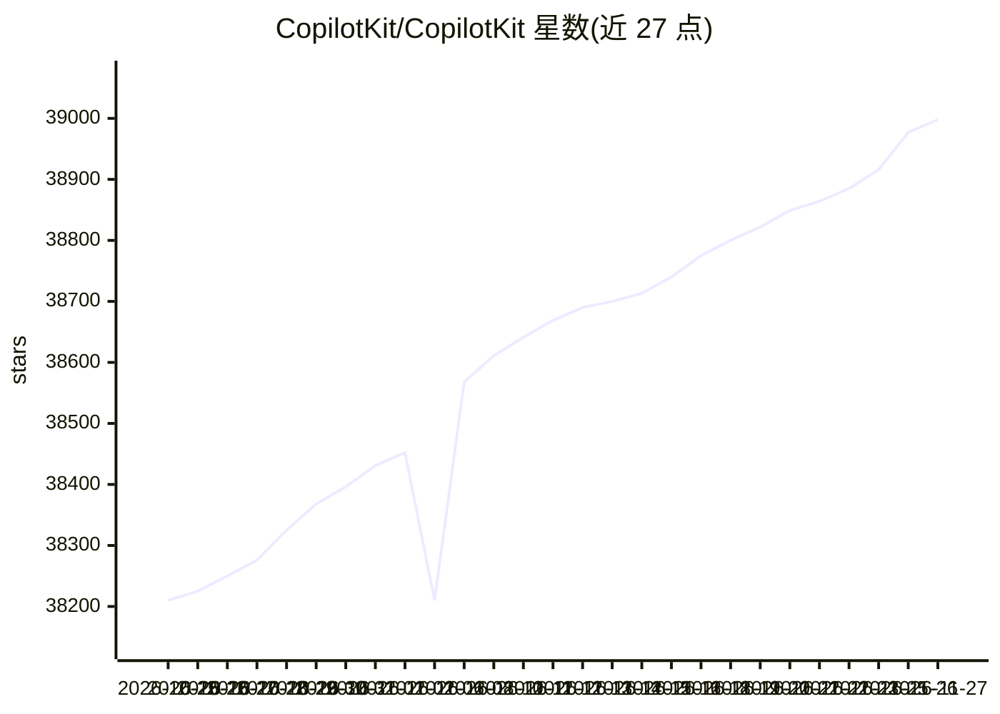

# CopilotKit/CopilotKit

⭐ 38,998 · TypeScript · MIT · 推送 2026-11-26 · [GitHub](https://github.com/CopilotKit/CopilotKit) · [官网](https://docs.copilotkit.ai) · 组织维护

**给 AI Agent 加前端界面的开源 React/Angular 等框架**

将已有 Agent 接入真实用户界面的前端技术栈：提供 React、Angular、Vue、React Native、Slack、Teams 等表面的聊天组件、生成式 UI、共享状态与 human-in-the-loop 能力，Agent 侧支持 LangGraph、CrewAI、Mastra、PydanticAI 等框架接入，事件通过其主导的 AG-UI 协议流式传输。生产层另有云托管或自托管的 CopilotKit Intelligence（Continual Learning、跨会话记忆、分析、频道基础设施）。核心 SDK 为 MIT 许可，Soar 为商业产品。

## 筛选速览

| 维度 | 判定 | 备注 |
|---|---|---|
| AI 角色 | `ai-ecosystem` | LLM/agent 周边工具 |
| 许可风险 | `permissive` | MIT |
| 部署形态 | `library` | 以包/库形式分发 |
| 模型依赖 | — | README 未给出锁定关系 |
| 硬件要求 | — | 无带数字的原话,不猜 |
| 安装摩擦 | `low` | 无编译、无系统依赖或容器化 |
| 成熟度 | `idea` | |

## 动量与使用信号

- 维护:`active` — 距上次 push 0.7 天,年发版 100,232 位贡献者
- 涨星:近 1 天 **+24**(自 20261016 起算)
- 下载:GitHub Release 附件 累计 397(100 个 release)
- 平台:WEB · 协议:MCP

## 能力要点

- 支持 React/Angular/Vue/React Native/Slack/Teams 多前端表面
- 生成式 UI 三种模式：注册组件、A2UI 声明式 spec、沙箱化 MCP Apps
- 基于 AG-UI 事件协议连接 Agent 与用户，支持工具调用渲染 UI 与人工审批
- useAgent 等底层 hooks 提供对 Agent 连接的程序化控制

## 适用场景

- 为已构建的 LangGraph/CrewAI Agent 加上聊天与生成式 UI 界面
- 构建需要人工确认环节的 Agent 应用
- 将 Agent 接入 Slack 或 Microsoft Teams 频道

## 场景标签

`Agent 框架` · 领域:Agent 开发

## 证据(README 行号)

> L19: **CopilotKit is the open-source stack for putting AI agents in front of real users.** Bring the agent you already b
> L84: Your agent handles reasoning and execution. CopilotKit turns its work into a product experience. Events stream over
> L141: **Agent frameworks.** LangGraph · Deep Agents · CrewAI · Mastra · Google ADK · PydanticAI · Microsoft Agent Framew

## 星数曲线

2026-10-25 38,210 → 2026-11-27 38,998（+788）

---
*卡片 v1 · prompt 1.4 · 生成 2026-11-22 · 置信度 high · 依据 README sha `d68f0c768a03` · [字段定义](../../DATASET.md)*
