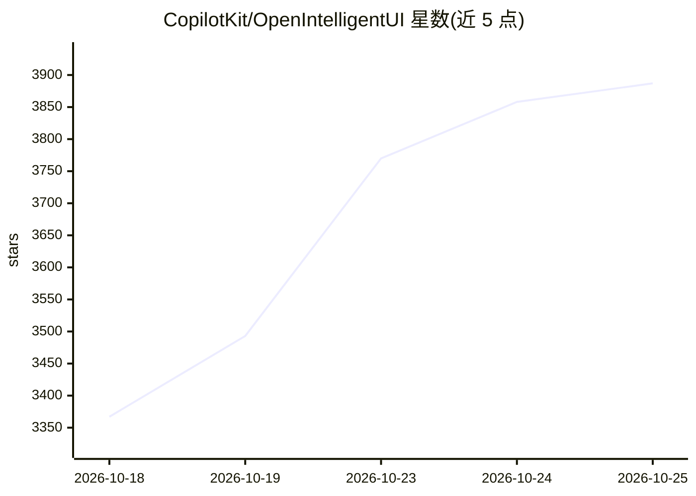

# CopilotKit/OpenIntelligentUI

⭐ 3,887 · TypeScript · MIT · 推送 2026-10-13 · [GitHub](https://github.com/CopilotKit/OpenIntelligentUI) · [官网](https://opengenerativeui.copilotkit.ai/) · 组织维护

**开源生成式 UI 聊天框架：把问题变成可交互的解释与工具**

基于 CopilotKit 与 AG-UI 构建的开源聊天界面：agent 根据任务在纯文本、原生组件和自定义交互 UI（3D 解释、图表、计算器、地图）之间选择呈现方式。Python Deep Agent 生成结构化任务答案，generateSandboxedUi 将 HTML/CSS/JS 流式注入隔离 iframe 形成交互控件。默认模型为 OpenAI chat-latest，Jev（jev-latest）负责可视化路由；需要 Node.js 22+、pnpm 9+、Python 3.12+ 与 uv，通过 git clone 与 make 命令运行，API key 可在界面填入且不落盘。

## 筛选速览

| 维度 | 判定 | 备注 |
|---|---|---|
| AI 角色 | `ai-native` | 本体是模型或模型工具 |
| 许可风险 | `permissive` | MIT |
| 部署形态 | `None` |  |
| 模型依赖 | — | README 未给出锁定关系 |
| 硬件要求 | — | 无带数字的原话,不猜 |
| 安装摩擦 | `low` | 无编译、无系统依赖或容器化 |
| 成熟度 | — | 结构信号不足 |

## 动量与使用信号

- 安装:github 包 `release-assets` 月下载无数据

## 能力要点

- agent 按任务自动选择文本、原生组件或自定义交互 UI 呈现
- generateSandboxedUi 将生成的 HTML/CSS/JS 流式注入隔离沙箱 iframe
- 内置 3D 解释、表格转图表、账单分摊计算器、USGS 地图行程等演示场景
- 可选独立 MCP server，暴露技能资源、提示模板与 assemble_document 工具

## 适用场景

- 克隆并接入自己的模型，改造成面向特定工作流的交互式问答界面
- 为知识解释、方案对比类问题生成可操作的可视化回答
- 研究生成式 UI / agent 驱动前端的参考实现

## 场景标签

`Agent 框架` · 领域:Agent 开发

## 证据(README 行号)

> L25: Ask a question, explore an idea, compare your options, or make a tool for the moment. The agent chooses a direct te
> L117: The Python Deep Agent uses a task-first system prompt and focused skills. CopilotKit carries the agent stream to t
> L105: The default model is `chat-latest`, OpenAI’s documented alias for the latest ChatGPT Instant model, requiring `OPE

## 星数曲线

2026-10-18 3,367 → 2026-10-25 3,887（+520）

---
*卡片 v1 · prompt 1.4 · 生成 2026-10-18 · 置信度 high · 依据 README sha `c8a0065e3fc9` · [字段定义](../../DATASET.md)*
