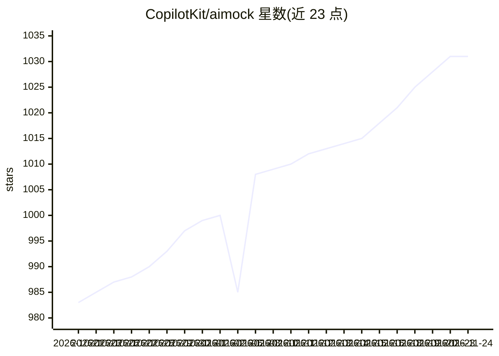

# CopilotKit/aimock

⭐ 1,031 · TypeScript · MIT · 推送 2026-11-20 · [GitHub](https://github.com/CopilotKit/aimock) · [官网](http://aimock.copilotkit.dev/) · 组织维护

**AI 应用测试用本地 mock 服务器：模拟 LLM API/MCP/向量库等**

面向 AI 应用测试的基础设施工具：将应用的 SDK 指向本地端口后，以确定性方式模拟 LLM API（11 个提供商 22 个 API 面）、图像/语音/视频生成、MCP 工具、A2A/AG-UI 协议、向量库、搜索与 rerank 等服务，无需 API key 与网络。支持录制真实 API 存为 fixture 并离线回放、故障注入（500/429/断流）、请求日志、Prometheus 指标，并提供 Vitest/Jest 插件与 Docker/Helm 部署。

## 筛选速览

| 维度 | 判定 | 备注 |
|---|---|---|
| AI 角色 | `ai-ecosystem` | LLM/agent 周边工具 |
| 许可风险 | `permissive` | MIT |
| 部署形态 | `library` | 以包/库形式分发 |
| 模型依赖 | — | README 未给出锁定关系 |
| 硬件要求 | — | 无带数字的原话,不猜 |
| 安装摩擦 | `low` | 无编译、无系统依赖或容器化 |
| 成熟度 | — | 结构信号不足 |

## 能力要点

- 单包单端口模拟 LLM API、MCP、A2A、AG-UI、向量库与搜索服务
- 录制真实 API 为 fixture 并确定性回放，含 token 用量与时序
- Chaos Testing 注入 500/429/断流/延迟等故障路径
- Vitest & Jest 零配置插件与 Docker/Helm CI 部署

## 适用场景

- AI 应用的端到端测试中替代真实 LLM API 调用
- 录制线上 API 流量后离线复现测试场景
- 测试应用对限流、断流、畸形响应等异常的处理
- CI/CD 中无网络依赖地运行 AI 相关测试

## 场景标签

 · 领域:AI 开发工具/测试基础设施

## 证据(README 行号)

> L3: **Mock infrastructure for AI application testing — point your SDK at one local port and every provider, protocol, an
> L14: One package, one port, zero dependencies. LLM APIs, image generation and
> L35: aimock mocks everything your AI app talks to:

## 星数曲线

2026-10-21 983 → 2026-11-24 1,031（+48）

---
*卡片 v1 · prompt 1.4 · 生成 2026-11-24 · 置信度 high · 依据 README sha `b4ff1d4c1f14` · [字段定义](../../DATASET.md)*
