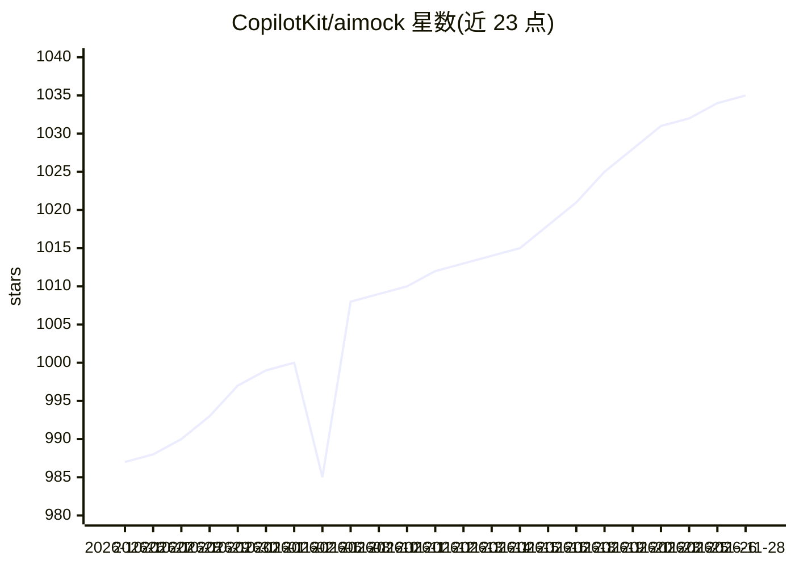

# CopilotKit/aimock

⭐ 1,035 · TypeScript · MIT · 推送 2026-11-26 · [GitHub](https://github.com/CopilotKit/aimock) · [官网](http://aimock.copilotkit.dev/) · 组织维护

**AI 应用的本地 Mock 基础设施：一个端口模拟全部外部依赖**

面向 AI 应用测试的本地模拟服务器：将 SDK 指向一个本地端口，即可确定性地模拟 LLM API（OpenAI/Claude/Gemini/Bedrock/Ollama 等 11 家 22 个 API 面）、MCP 工具、A2A/AG-UI 协议、向量数据库与搜索服务。提供录制回放（含时序与 token 用量）、混沌测试（错误/断流/限流）、模型异常行为模拟、请求日志、Prometheus 指标，并带 Vitest/Jest 插件与 Docker/Helm 镜像用于 CI/CD。MIT 许可，零依赖，npm 分发。

## 筛选速览

| 维度 | 判定 | 备注 |
|---|---|---|
| AI 角色 | `ai-ecosystem` | LLM/agent 周边工具 |
| 许可风险 | `permissive` | MIT |
| 部署形态 | `library` | 以包/库形式分发 |
| 模型依赖 | local-ok | 支持本地模型 |
| 硬件要求 | — | 无带数字的原话,不猜 |
| 安装摩擦 | `low` | 无编译、无系统依赖或容器化 |
| 成熟度 | — | 结构信号不足 |

## 能力要点

- 一个包一个端口模拟 LLM/MCP/A2A/AG-UI/向量库/搜索
- 录制真实 API 为 fixture 并确定性回放，保留时序与 token 用量
- 混沌测试与模型异常行为（无效参数/限流/断流/拒绝）
- 请求日志、OpenAPI 路由目录、Prometheus 指标与测试框架插件

## 适用场景

- 为 AI 应用编写不依赖真实 API key 的单元与端到端测试
- 在 CI/CD 中用 Docker/Helm 稳定运行 LLM 依赖的测试套件
- 录制一次真实 API 调用，离线回放进行回归测试
- 模拟错误、限流、断流等异常路径验证容错逻辑

## 场景标签

 · 领域:AI 开发工具/测试

## 证据(README 行号)

> L3: **Mock infrastructure for AI application testing — point your SDK at one local port and every provider, protocol, an
> L35: aimock mocks everything your AI app talks to:
> L46: Run them all on one port with `npx @copilotkit/aimock --config aimock.json`, or use the programmatic API to compose

## 星数曲线

2026-10-26 987 → 2026-11-28 1,035（+48）

---
*卡片 v1 · prompt 1.4 · 生成 2026-11-26 · 置信度 high · 依据 README sha `b989bb95bf57` · [字段定义](../../DATASET.md)*
