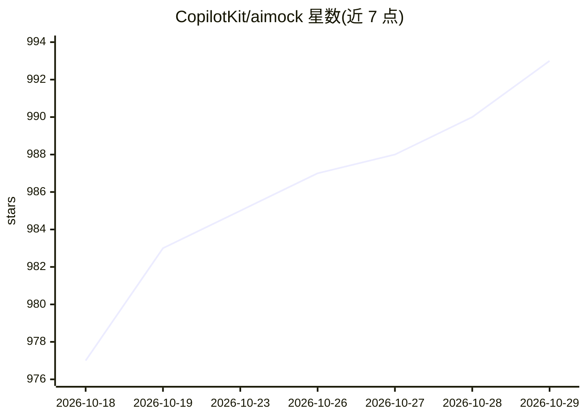

# CopilotKit/aimock

⭐ 993 · TypeScript · MIT · 推送 2026-10-27 · [GitHub](https://github.com/CopilotKit/aimock) · [官网](http://aimock.copilotkit.dev/) · 组织维护

**AI 应用测试用的统一 mock 服务器：一个端口模拟全部 LLM API 与协议**

面向 AI 应用开发者的测试基础设施：通过一个 npm 包在单一本地端口上确定性模拟 11 家提供商 22 个 API 面（OpenAI、Claude、Gemini、Bedrock、Azure、Ollama、Cohere、OpenRouter 等），以及图像/语音/视频生成、embeddings、MCP 工具、A2A、AG-UI 事件流、向量数据库（Pinecone/Qdrant/ChromaDB）、搜索/重排/审核。支持录制真实 API 并离线回放（含 token 用量与时间信息）、混沌测试（429/断流/500）、模型行为异常注入、请求日志与 OpenAPI 目录。零运行时依赖，仅用 Node.js 内置模块。提供 Vitest/Jest 插件、GitHub Action、CLI、Docker 与 Helm。限制：托管 file_search 执行不支持；GPT-Live 不合成语音。

## 筛选速览

| 维度 | 判定 | 备注 |
|---|---|---|
| AI 角色 | `ai-ecosystem` | LLM/agent 周边工具 |
| 许可风险 | `permissive` | MIT |
| 部署形态 | `library` | 以包/库形式分发 |
| 模型依赖 | local-ok | 支持本地模型 |
| 硬件要求 | — | 无带数字的原话,不猜 |
| 安装摩擦 | `low` | 无编译、无系统依赖或容器化 |
| 成熟度 | — | 结构信号不足 |

## 能力要点

- 11 家提供商 22 个 API 面的单端口确定性模拟
- 录制真实 API 为 fixture 并离线回放（含用量/成本与逐帧时间戳）
- 混沌测试与模型行为异常注入（429/断流/无效工具参数等）
- MCP 场景化 fakes、录制与未使用 fake 检测报告

## 适用场景

- 在不调真实 API、无 key 无网络的条件下跑 AI 应用单元/e2e 测试
- 测试应用的限流重试、断流恢复与模型行为异常处理
- 录制多轮对话加工具调用的真实轨迹做回归测试
- 在 CI 中用 GitHub Action/Docker/Helm 跑 fixture 测试与每日漂移检测

## 场景标签

 · 领域:开发者工具/AI 测试基础设施

## 证据(README 行号)

> L3: **Mock infrastructure for AI application testing — point your SDK at one local port and every provider, protocol, an
> L35: aimock mocks everything your AI app talks to:
> L39: |**LLMock**|OpenAI (Chat/Responses/Realtime GA/GPT-Live), Claude, Gemini (REST/Live/Interactions/Embeddings), Bedro

## 星数曲线

2026-10-18 977 → 2026-10-29 993（+16）

---
*卡片 v1 · prompt 1.4 · 生成 2026-10-21 · 置信度 high · 依据 README sha `266046acc275` · [字段定义](../../DATASET.md)*
