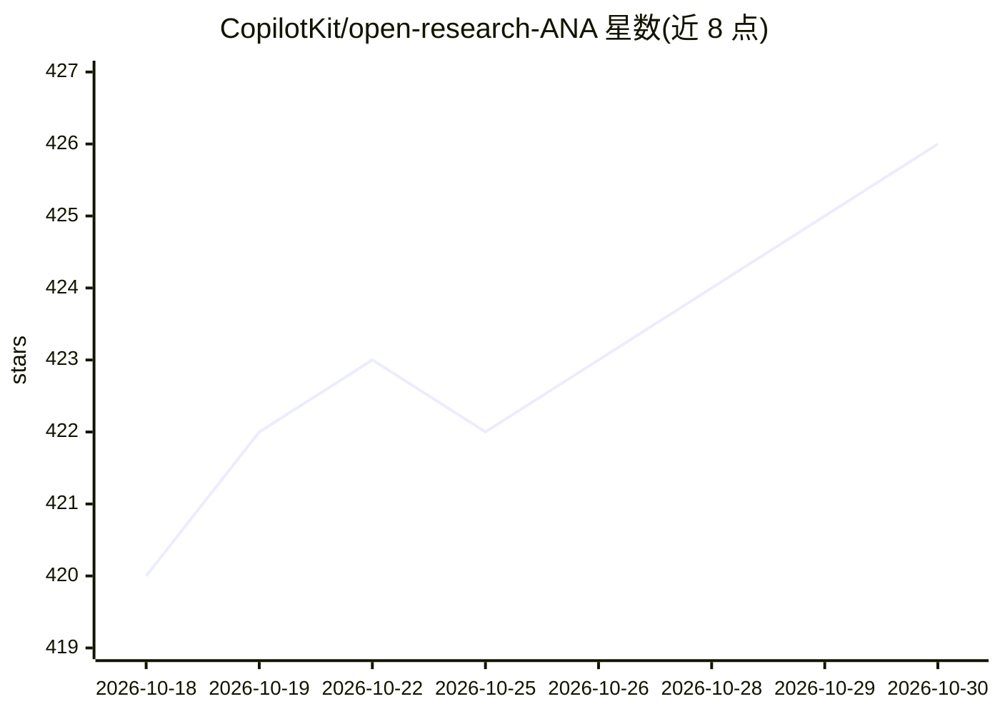

# CopilotKit/open-research-ANA

⭐ 426 · TypeScript · 推送 2026-10-28 · [GitHub](https://github.com/CopilotKit/open-research-ANA) · [官网](https://open-research-ana.vercel.app) · 组织维护

**演示用 AI 研究画布应用：实时搜索加人机协同**

基于 CopilotKit、Tavily 与 LangGraph 构建的 Agent Native 应用（ANA）演示项目：提供研究画布界面，结合 Human-in-the-Loop 能力与 Tavily 实时搜索，由 LangGraph 驱动 agent 处理研究任务。运行需要 pnpm、Docker、LangGraph CLI，并配置 OpenAI、Tavily、LangSmith、CopilotKit 四项 API key；分 agent 与前端两部分本地启动。README 声明该项目已并入 CopilotKit 主仓库（examples/showcases/research-canvas），最新版本在主仓库维护。

## 筛选速览

| 维度 | 判定 | 备注 |
|---|---|---|
| AI 角色 | `ai-native` | 本体是模型或模型工具 |
| 许可风险 | `none` | — |
| 部署形态 | `library` | 以包/库形式分发 |
| 模型依赖 | — | README 未给出锁定关系 |
| 硬件要求 | — | 无带数字的原话,不猜 |
| 安装摩擦 | `low` | 无编译、无系统依赖或容器化 |
| 成熟度 | — | 结构信号不足 |

## 能力要点

- 研究画布应用，结合 Human-in-the-Loop 与 Tavily 实时搜索
- 基于 LangGraph 与 CopilotKit 的 agent 架构
- 通过 npx copilotkit dev 建立本地 agent 隧道

## 适用场景

- 体验 CopilotKit + LangGraph 构建的人机协同研究画布
- 作为 Agent Native 应用的参考示例学习其架构
- 在此基础上二次开发实时搜索研究工具

## 场景标签

`科研工具` · 领域:学习与行业

## 证据(README 行号)

> L3: This demo showcases ANA (Agent Native Application), a research canvas app that combines Human-in-the-Loop capabiliti
> L5: Powered by LangGraph, it simplifies complex research tasks, making them more interactive and efficient.

## 星数曲线

2026-10-18 420 → 2026-10-30 426（+6）

---
*卡片 v1 · prompt 1.4 · 生成 2026-10-21 · 置信度 high · 依据 README sha `e22afeab0901` · [字段定义](../../DATASET.md)*
