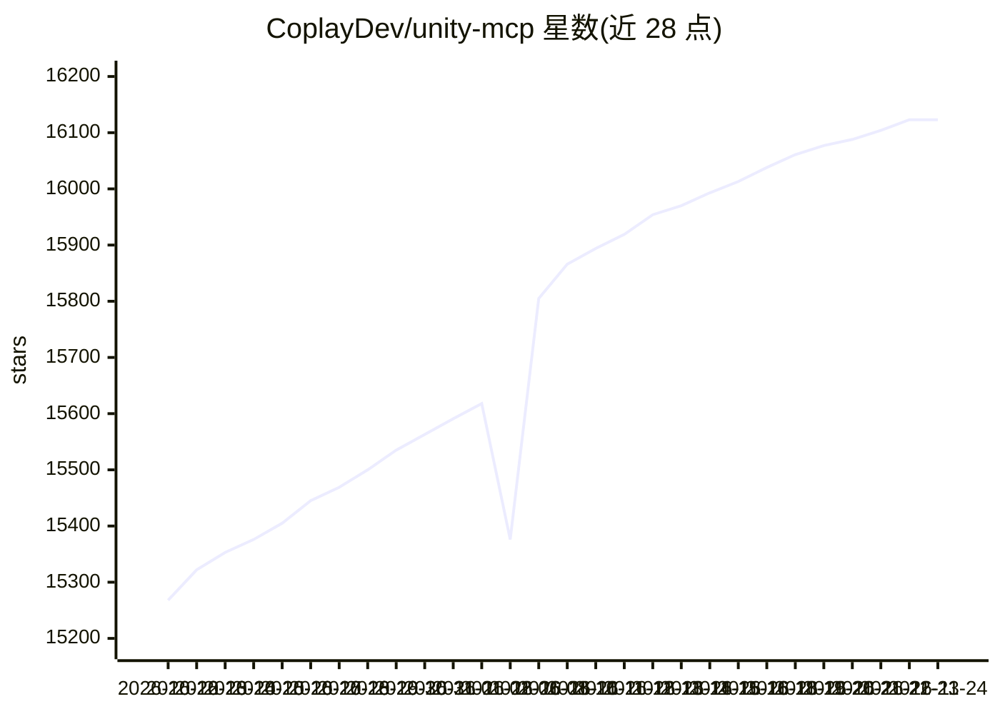

# CoplayDev/unity-mcp

⭐ 16,138 · C# · MIT · 推送 2026-11-17 · [GitHub](https://github.com/CoplayDev/unity-mcp) · [官网](https://coplaydev.github.io/unity-mcp/) · 组织维护 · 中文 README

**Unity 编辑器的 MCP 桥：让 AI 助手操作资产、场景与脚本**

通过 Model Context Protocol 将 Unity 编辑器接入各类 MCP 客户端，提供 50 个工具入口，支持自然语言创建场景与 GameObject、编辑 C# 脚本、管理资产、运行测试、性能分析与构建。安装方式为 Unity Package Manager 添加 git URL 或经 OpenUPM，要求 Unity 2021.3 LTS 至 6.x 及 Python 3.10+（经 uv）。支持多 Unity 实例路由、工具分组、Roslyn 脚本校验与带鉴权的远程服务器。MIT 许可，由 Aura 赞助维护，与 Unity Technologies 无隶属关系。

## 筛选速览

| 维度 | 判定 | 备注 |
|---|---|---|
| AI 角色 | `ai-ecosystem` | LLM/agent 周边工具 |
| 许可风险 | `permissive` | MIT |
| 部署形态 | `None` |  |
| 模型依赖 | — | README 未给出锁定关系 |
| 硬件要求 | — | 无带数字的原话,不猜 |
| 安装摩擦 | `low` | 无编译、无系统依赖或容器化 |
| 成熟度 | — | 结构信号不足 |

## 动量与使用信号

- 维护:`active` — 距上次 push 9.5 天,年发版 64,82 位贡献者
- 涨星:近 1 天 **+43**(自 20261016 起算)
- 下载:GitHub Release 附件 累计 10,518(68 个 release)
- 平台:— · 协议:MCP

## 能力要点

- 50 个 MCP 工具入口，任意 MCP 客户端可用
- 支持多 Unity 实例路由与工具分组（vfx/animation/ui/testing 等）
- 提供 Roslyn 脚本校验与带鉴权的远程服务器部署
- MIT 许可，另提供面向开发者的自动测试工具 Autopilot

## 适用场景

- 用自然语言在 Unity 中创建场景与 GameObject
- 让 AI 助手批量管理资产、编辑 C# 脚本并运行测试
- 自动化游戏开发中的构建与性能分析流程

## 场景标签

`编码 Agent` · 领域:编码与开发

## 证据(README 行号)

> L8:  Create your Unity apps with LLMs. MCP for Unity bridges AI assistants — Claude, Codex, VS Code, local LLMs, and mor
> L24: Control the Unity Editor in natural language from any MCP client — create scenes & GameObjects, edit C# scripts, ma

## 星数曲线

2026-10-22 15,268 → 2026-11-24 16,123（+855）

---
*卡片 v1 · prompt 1.4 · 生成 2026-11-22 · 置信度 high · 依据 README sha `bacc9432bb70` · [字段定义](../../DATASET.md)*
