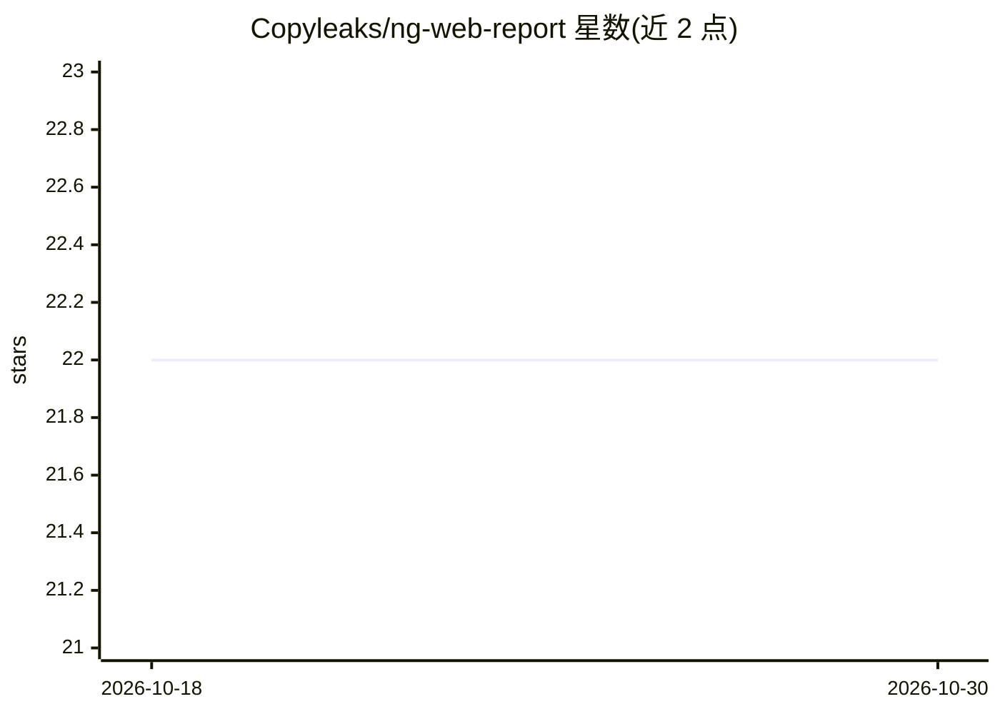

# Copyleaks/ng-web-report

⭐ 22 · TypeScript · NOASSERTION · 推送 2026-10-16 · [GitHub](https://github.com/Copyleaks/ng-web-report) · [官网](https://copyleaks.com) · 组织维护

**面向 Angular 的 Copyleaks 抄袭与 AI 检测报告 UI 组件**

Copyleaks 维护的 Angular npm 模块 @copyleaks/ng-web-report，在应用内渲染完整的抄袭检测与 AI 内容检测报告界面。开发者配置三个后端接口（crawledVersion/completeResults/result）传入组件即可展示报告；组件本身不执行检测，数据来自 Copyleaks API。功能包括四种布局（OneToMany/OneToOne/OnlyAi/WritingFeedback）、实时结果推送、写作反馈与语法纠正展示、自定义插槽（cr-actions/cr-custom-tabs 等）、i18n 与 RTL 支持。支持 Angular 19（2.x）与 Angular 13（1.x 维护版）。

## 筛选速览

| 维度 | 判定 | 备注 |
|---|---|---|
| AI 角色 | `ai-ecosystem` | LLM/agent 周边工具 |
| 许可风险 | `none` | NOASSERTION |
| 部署形态 | `library` | 以包/库形式分发 |
| 模型依赖 | — | README 未给出锁定关系 |
| 硬件要求 | — | 无带数字的原话,不猜 |
| 安装摩擦 | `low` | 无编译、无系统依赖或容器化 |
| 成熟度 | — | 结构信号不足 |

## 能力要点

- 四种报告布局：OneToMany/OneToOne/OnlyAi/WritingFeedback
- 通过三个可插拔端点接入自有 API，组件负责渲染
- 实时结果推送（ReportRealtimeResultsService.pushNewResults）
- 自定义插槽支持替换动作栏、标签页、结果列表与锁定结果模板

## 适用场景

- 在自家应用内嵌入 Copyleaks 抄袭与 AI 检测报告
- 教育/出版平台展示带高亮与置信度的 AI 内容检测结果
- 自定义品牌化的报告界面与升级提示模板

## 场景标签

 · 领域:内容原创性检测/前端组件

## 证据(README 行号)

> L25: Stop building a plagiarism/AI report UI from scratch. **`@copyleaks/ng-web-report`** is a battle-tested Angular mod
> L82: |🔌|**Pluggable Endpoints**|Bring your own API — just point the component at three URLs.|
> L189: |`reportEndpointConfig`|`IClsReportEndpointConfigModel`|✅|Endpoints + headers for fetching report data.|

## 星数曲线

2026-10-18 22 → 2026-10-30 22（+0）

---
*卡片 v1 · prompt 1.4 · 生成 2026-10-28 · 置信度 high · 依据 README sha `dbce97a231e0` · [字段定义](../../DATASET.md)*
