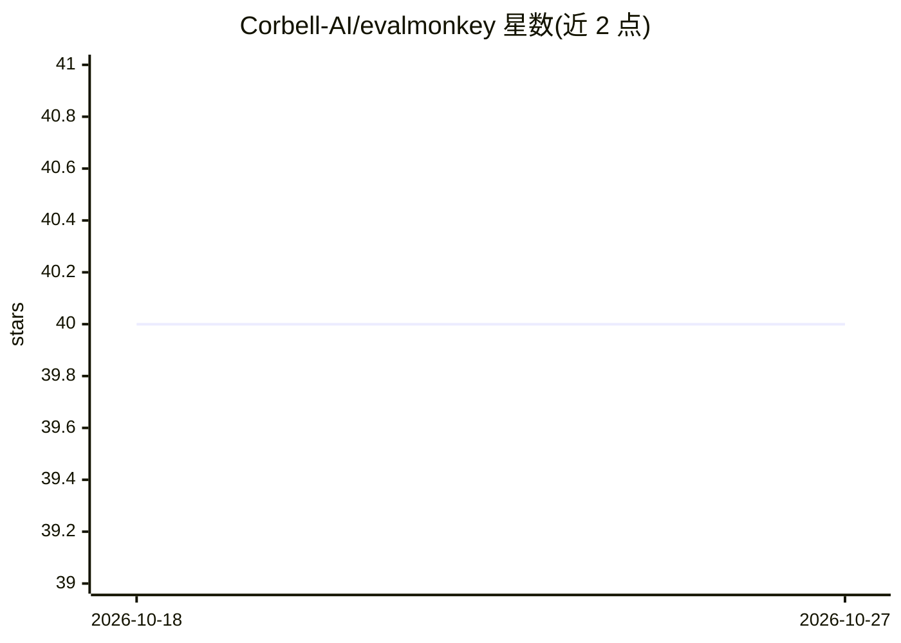

# Corbell-AI/evalmonkey

⭐ 40 · Python · Apache-2.0 · 推送 2026-06-11 · [GitHub](https://github.com/Corbell-AI/evalmonkey) · 组织维护

**面向 agent 开发者的本地基准测试与混沌工程 CLI 框架**

严格本地运行的开源执行框架，供开发者对自己的 AI agent 做 evalmonkey CLI 运行标准基准（GSM8K、MMLU、SWE-Bench 等 19 个 HuggingFace 数据集）、注入 28 种混沌故障（头部篡改、延迟尖峰、schema 破坏）、本地存储分数以跟踪 Production Reliability 指标，并生成改进用例与 agent_card 徽章。通过纯 HTTP 对接任意运行中的 agent（11 种框架原生支持），评分裁判 LLM 支持 Bedrock/Azure/GCP/OpenAI/Ollama。安装走 git clone + pip install -e；仅文本基准，无视觉/音频依赖。

## 筛选速览

| 维度 | 判定 | 备注 |
|---|---|---|
| AI 角色 | `ai-ecosystem` | LLM/agent 周边工具 |
| 许可风险 | `permissive` | Apache-2.0 |
| 部署形态 | `library` | 以包/库形式分发 |
| 模型依赖 | local-ok | 支持本地模型 |
| 硬件要求 | — | 无带数字的原话,不猜 |
| 安装摩擦 | `low` | 无编译、无系统依赖或容器化 |
| 成熟度 | — | 结构信号不足 |

## 能力要点

- 19 个来自 HuggingFace 的标准基准数据集开箱即用
- 28 种混沌注入（17 客户端 + 11 服务端，含语音专用 profile）
- 纯 HTTP 对接任意 agent，11 种框架原生支持，无需改代码
- 低分自动生成 traces.json/evals.json/improvement_prompt.md

## 适用场景

- 对自己的 agent 跑标准基准并跟踪生产可靠性分数
- 通过混沌注入测试 agent 在异常输入下的韧性
- 用生产日志自制 CSV/JSON 基准做回归评测

## 场景标签

`模型评测` · 领域:评测与运维

## 证据(README 行号)

> L16:  Agent Benchmarking & Chaos Engineering Framework
> L23: **EvalMonkey** is the ultimate, strictly local, open-source execution harness that enables developers to:
> L34: - **11 Agent Frameworks natively supported**: CrewAI, LangChain, LlamaIndex, LangGraph, Pydantic AI, OpenAI Agents,

## 星数曲线

2026-10-18 40 → 2026-10-27 40（+0）

---
*卡片 v1 · prompt 1.4 · 生成 2026-10-25 · 置信度 high · 依据 README sha `62b9b8980f65` · [字段定义](../../DATASET.md)*
