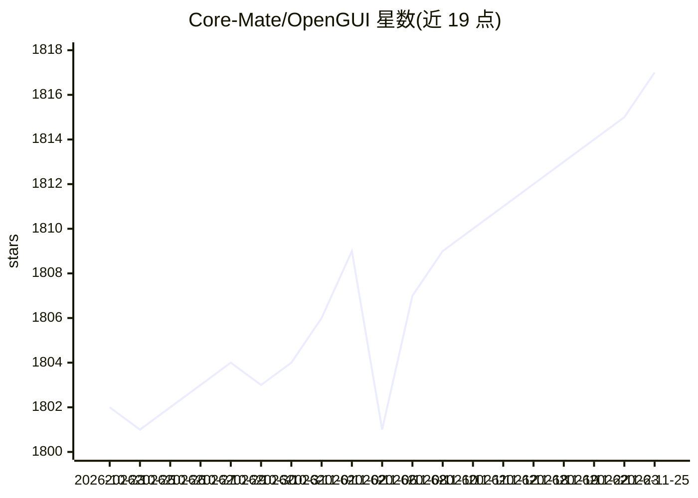

# Core-Mate/OpenGUI

⭐ 1,817 · HTML · NOASSERTION · 推送 2026-11-16 · [GitHub](https://github.com/Core-Mate/OpenGUI) · [官网](https://opengui.ai/) · 组织维护 · 中文 README

**Android GUI agent 框架：让 AI 看屏、规划并操作真实手机应用**

面向 Android 的移动 GUI agent 框架，通过截图理解界面并以自然语言指令完成手机操作、应用测试与信息整理任务。以插件形式运行于 WorkBuddy 或 DeepSeek Harness 宿主，安装脚本部署后授权 Skill 与 MCP 连接器即可使用，无需完整后端部署；另提供完整后端栈自托管路径，支持 Feishu/Telegram/Discord/REST API 派发任务。macOS 为主，DSH 另有 Linux/Windows 手动安装方式；GUI 执行要求具备图像输入与工具调用的模型。

## 筛选速览

| 维度 | 判定 | 备注 |
|---|---|---|
| AI 角色 | `ai-native` | 本体是模型或模型工具 |
| 许可风险 | `none` | NOASSERTION |
| 部署形态 | `None` |  |
| 模型依赖 | — | README 未给出锁定关系 |
| 硬件要求 | — | 无带数字的原话,不猜 |
| 安装摩擦 | `low` | 无编译、无系统依赖或容器化 |
| 成熟度 | `idea` | |

## 能力要点

- 基于真实截图理解界面，执行点击/滑动/输入/返回等多步手机操作
- 插件化接入 WorkBuddy 与 DeepSeek Harness，通过 MCP 连接器授权
- 完整后端栈支持自托管，可经 Feishu/Telegram/Discord/REST API 派发任务
- 应用测试可记录问题、复现步骤与截图并汇总结果

## 适用场景

- 用自然语言让 AI 在真机上完成多步骤手机操作任务
- 对应用功能做自动化测试并留存问题与截图
- 准备社交媒体图文草稿、整理屏幕信息

## 场景标签

`GUI 自动化` `Agent 框架` · 领域:Agent 开发

## 证据(README 行号)

> L13:  A mobile GUI agent framework for Android.
> L15:  OpenGUI helps AI agents see, understand, and operate Android app interfaces on real devices.
> L22: OpenGUI uses real screenshots to understand apps and carry out phone operations and testing tasks from natural-lang

## 星数曲线

2026-10-23 1,802 → 2026-11-25 1,817（+15）

---
*卡片 v1 · prompt 1.4 · 生成 2026-11-24 · 置信度 high · 依据 README sha `8d8c0229c14c` · [字段定义](../../DATASET.md)*
