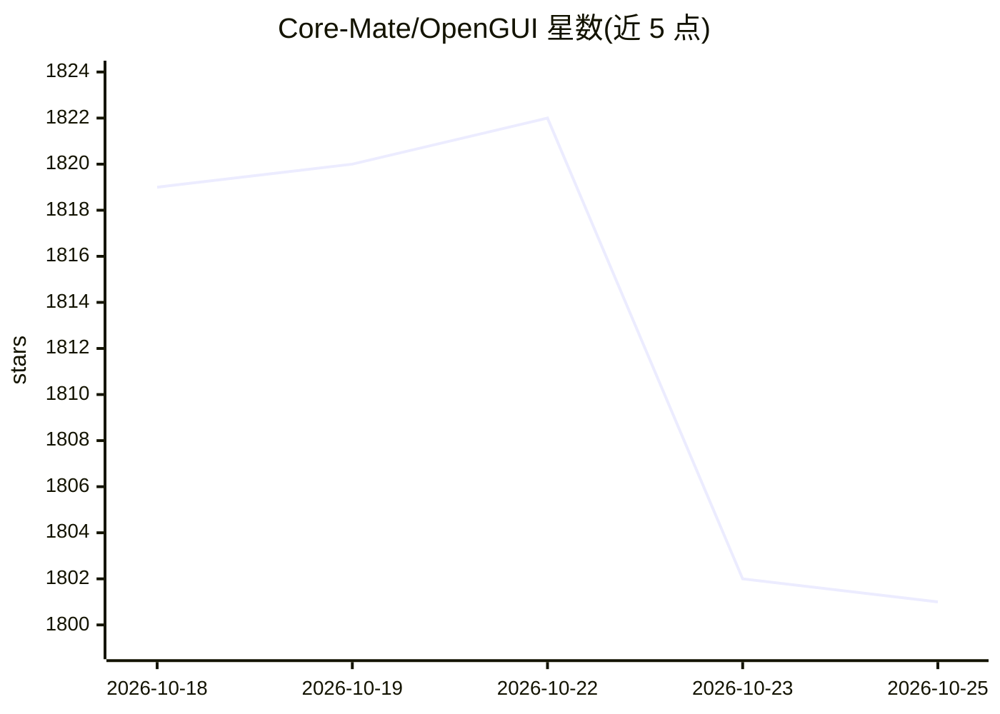

# Core-Mate/OpenGUI

⭐ 1,802 · HTML · NOASSERTION · 推送 2026-10-18 · [GitHub](https://github.com/Core-Mate/OpenGUI) · [官网](https://opengui.ai/) · 组织维护 · 中文 README

**Android 手机 GUI agent 框架：让 AI 看屏、规划并操作真实应用**

面向 phone-use AI 的移动端 GUI agent 框架：基于真实截图理解 Android 应用界面，执行点击、滑动、输入、多步导航等手机操作，也支持应用功能测试、问题记录（复现步骤与截图）与信息整理。提供三种接入方式：WorkBuddy 插件（macOS）、DeepSeek Harness（DSH）插件，以及可自托管后端与 Android 客户端的完整栈（含 CLI、REST API、Discord/Telegram/Feishu 等远程派发）。限制：WorkBuddy 插件为 public-testing 预发布版，完整栈 Android 客户端要求 Android 11+、USB 调试与无障碍权限；GUI 执行需要支持图像输入与工具调用的模型。

## 筛选速览

| 维度 | 判定 | 备注 |
|---|---|---|
| AI 角色 | `ai-ecosystem` | LLM/agent 周边工具 |
| 许可风险 | `none` | NOASSERTION |
| 部署形态 | `None` |  |
| 模型依赖 | — | README 未给出锁定关系 |
| 硬件要求 | — | 无带数字的原话,不猜 |
| 安装摩擦 | `low` | 无编译、无系统依赖或容器化 |
| 成熟度 | `idea` | |

## 能力要点

- 基于真实截图的自然语言手机操作（打开/点击/滑动/输入/多步导航）
- 应用测试：记录问题、复现步骤与截图并汇总结果
- WorkBuddy / DeepSeek Harness 插件接入，无需完整后端部署
- 自托管完整栈含 pnpm CLI、REST API 与 Discord/Telegram/Feishu 远程派发

## 适用场景

- 让 AI agent 按自然语言指令在真实 Android 手机上完成多步操作
- 用 AI 测试应用功能并自动记录缺陷与截图
- 从 IM 或编码 agent 远程派发 Android 应用任务

## 场景标签

`Agent 框架` `GUI 自动化` · 领域:Agent 开发

## 证据(README 行号)

> L13:  A mobile GUI agent framework for Android.
> L15:  OpenGUI helps AI agents see, understand, and operate Android app interfaces on real devices.
> L18:  Install the plugin, connect your phone, and describe your task. No full backend deployment is required.

## 星数曲线

2026-10-18 1,819 → 2026-10-25 1,801（-18）

---
*卡片 v1 · prompt 1.4 · 生成 2026-10-21 · 置信度 high · 依据 README sha `db24df64aa29` · [字段定义](../../DATASET.md)*
