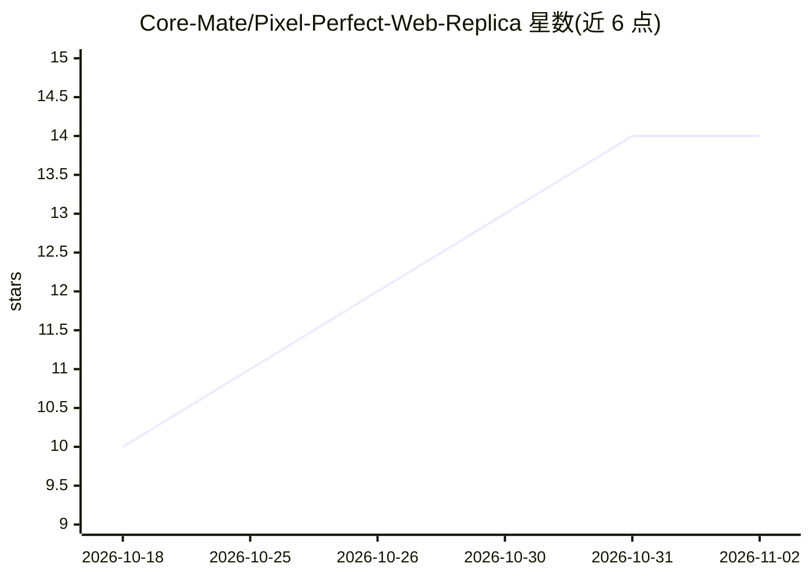

# Core-Mate/Pixel-Perfect-Web-Replica

⭐ 14 · Python · MIT · 推送 2026-05-09 · [GitHub](https://github.com/Core-Mate/Pixel-Perfect-Web-Replica) · [官网](https://github.com/Core-Mate/Pixel-Perfect-Web-Replica) · 组织维护 · 中文 README

**让 Codex/Claude Code 把公开网页复刻为本地像素级副本的 AI 技能**

面向 Codex 与 Claude Code 的 agent 技能（SKILL.md）：给定公开 URL 后，指示 agent 抓取同源 HTML/CSS/JS/媒体资源到本地，用静态服务器运行副本，对比桌面与移动端截图并修复保真问题，同时生成可替换资源清单（REPLACEABLE_RESOURCES.md、resources.json 等）供品牌重塑参考。也提供独立 Python 脚本 mirror_public_page.py 可不经 agent 直接使用。安全边界限定为公开可访问页面，禁止绕过登录、付费墙等访问控制。

## 筛选速览

| 维度 | 判定 | 备注 |
|---|---|---|
| AI 角色 | `ai-ecosystem` | LLM/agent 周边工具 |
| 许可风险 | `permissive` | MIT |
| 部署形态 | `library` | 以包/库形式分发 |
| 模型依赖 | locked-api |  |
| 硬件要求 | — | 无带数字的原话,不猜 |
| 安装摩擦 | `low` | 无编译、无系统依赖或容器化 |
| 成熟度 | — | 结构信号不足 |

## 能力要点

- 镜像公开网页的同源静态资源并在本地静态服务器运行
- 桌面/移动端截图对比的 agent 视觉 QA 流程
- 生成可替换品牌资源清单（logo/字体/OG 图/CTA 链接等）
- 附独立 Python 脚本，可不依赖 agent 直接镜像

## 适用场景

- 学习公开落地页的实现方式
- 重设计前搭建本地沙盒页面
- 品牌重塑前生成可替换资产清单
- 测试 AI 前端 agent 的视觉保真能力

## 场景标签

`网页抓取` · 领域:效率与自动化

## 证据(README 行号)

> L7: Paste a URL. Codex or Claude Code will mirror public HTML/CSS/JS/media assets, run the page locally, verify desktop 
> L114: ├── SKILL.md                         # Core agent skill instructions

## 星数曲线

2026-10-18 10 → 2026-11-02 14（+4）

---
*卡片 v1 · prompt 1.4 · 生成 2026-10-31 · 置信度 high · 依据 README sha `1c7990413500` · [字段定义](../../DATASET.md)*
