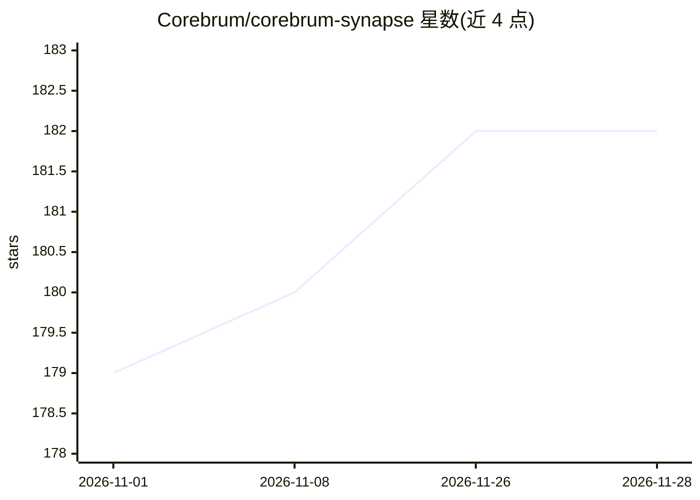

# Corebrum/corebrum-synapse

⭐ 182 · C · Apache-2.0 · 推送 2026-11-26 · [GitHub](https://github.com/Corebrum/corebrum-synapse) · [官网](https://corebrum.com/synapse) · 组织维护

**把 ROS 2 机器人接入多种 AI Agent 平台的插件层**

Corebrum Synapse（前身为 AgenticROS）是一个面向 ROS 2 机器人的 AI Agent 接口层：通过 OpenClaw 插件与一个统一的 MCP 服务器，把机器人能力（快照、测深、找物、跟随、底盘驱动）以工具形式暴露给 Claude（Code/Desktop/Dispatch）、Codex CLI、Hermes、Antigravity CLI、Gemini 等平台；本地路径可指向 Ollama 的 qwen3-vl 模型而不用云端 API。核心含声明式 mission 编排、基于模式匹配的自然语言目标编译器（不依赖 LLM）、多机器人编队发现与任务取消/交接。安装为一条 npx 命令，需 Node ≥ 20 与 ROS 2 环境。

## 筛选速览

| 维度 | 判定 | 备注 |
|---|---|---|
| AI 角色 | `ai-ecosystem` | LLM/agent 周边工具 |
| 许可风险 | `permissive` | Apache-2.0 |
| 部署形态 | `self-host` | docker 或自建部署 |
| 模型依赖 | local-ok | 支持本地模型 |
| 硬件要求 | — | 无带数字的原话,不猜 |
| 安装摩擦 | `low` | 无编译、无系统依赖或容器化 |
| 成熟度 | — | 结构信号不足 |

## 能力要点

- 一套工具面通过 MCP 服务器同时服务 Claude Code/Desktop/Dispatch、Codex、Hermes、Antigravity CLI
- 本地 VLM 路径：OpenClaw/Hermes 指向本机 Ollama（如 qwen3-vl:8b-instruct），无需云端 API key
- 能力清单（capability manifest）+ 声明式 mission 图 + 规则式自然语言目标编译器
- 多机器人编队发现、心跳在线状态与跨 Agent 的共享任务记录

## 适用场景

- 用自然语言指令驱动 ROS 2 机器人并获取相机/深度读数
- 在 Jetson 等边缘设备上用本地 Ollama 模型控制机器人
- 让多个不同厂商的 Agent 协作或交接同一个机器人任务
- 在 Gazebo 仿真中演示 AMR 与六自由度机械臂

## 场景标签

`Agent 框架` · 领域:Agent 开发

## 证据(README 行号)

> L20: Corebrum Synapse turns ROS 2 robots into agent-native machines. Speak, type, or message — and your robot perceives,
> L66: - **Adapters**: OpenClaw plugin (`packages/synapse-openclaw`, including NemoClaw); MCP server (`packages/synapse-cl

## 星数曲线

2026-11-01 179 → 2026-11-28 182（+3）

---
*卡片 v1 · prompt 1.4 · 生成 2026-11-28 · 置信度 mid · 依据 README sha `5c8ade8b35a4` · [字段定义](../../DATASET.md)*
