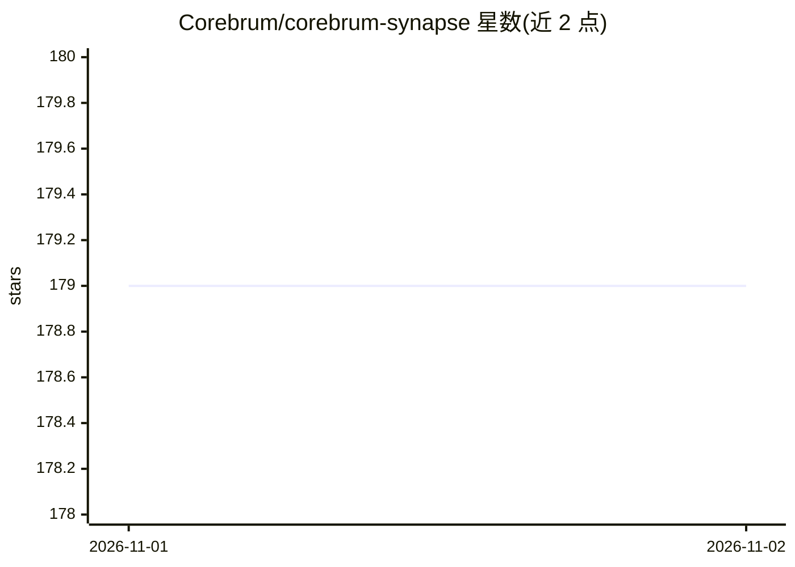

# Corebrum/corebrum-synapse

⭐ 179 · C · Apache-2.0 · 推送 2026-10-31 · [GitHub](https://github.com/Corebrum/corebrum-synapse) · [官网](https://agenticros.com) · 组织维护

**把 ROS 2 机器人接入各类 AI agent 的接口层**

面向 ROS 2 机器人的 agent 接口层：通过 OpenClaw 插件、MCP server（Claude Code/Desktop/Dispatch、Codex、Hermes、Antigravity CLI）和 Gemini CLI 适配器，把相机、深度传感器、电机与 cmd_vel 暴露为统一工具面，支持能力清单、声明式任务链 run_mission、基于规则匹配的自然语言目标规划（无 LLM 依赖）、多机器人舰队发现与跨 agent 共享记忆。感知层含相机快照与 YOLOv8n 目标检测；可选本地 Ollama 视觉语言模型替代云端 API。经 npx @corebrum/synapse 一条命令安装（需 Node ≥ 20）。

## 筛选速览

| 维度 | 判定 | 备注 |
|---|---|---|
| AI 角色 | `ai-ecosystem` | LLM/agent 周边工具 |
| 许可风险 | `permissive` | Apache-2.0 |
| 部署形态 | `self-host` | docker 或自建部署 |
| 模型依赖 | local-ok | 支持本地模型 |
| 硬件要求 | — | 无带数字的原话,不猜 |
| 安装摩擦 | `low` | 无编译、无系统依赖或容器化 |
| 成熟度 | — | 结构信号不足 |

## 能力要点

- 一套 ROS 2 工作区适配 OpenClaw/Claude/Codex/Hermes/Gemini 等多种 agent 平台
- run_mission 声明式任务链与规则式自然语言目标编译（无 LLM 依赖）
- 多机器人舰队发现、按能力筛选与跨 agent 共享任务记录
- 本地 Ollama VLM（qwen3-vl）控制机器人，无需云端 API

## 适用场景

- 让 Claude Code、Codex 等 agent 直接对话并控制 ROS 2 机器人
- 多机器人舰队中按能力分派任务步骤
- Jetson/Pi 等边缘设备上用本地 Ollama 模型驱动机器人

## 场景标签

`Agent 框架` · 领域:Agent 开发

## 证据(README 行号)

> L22: Corebrum Synapse turns ROS 2 robots into agent-native machines. Speak, type, or message — and your robot perceives,
> L38: Corebrum Synapse is built so that new adapters (LangGraph, OpenAI, local models, voice stacks, etc.) can be added w
> L68: - **Adapters**: OpenClaw plugin (`packages/synapse-openclaw`, including NemoClaw); MCP server (`packages/synapse-cl

## 星数曲线

2026-11-01 179 → 2026-11-02 179（+0）

---
*卡片 v1 · prompt 1.4 · 生成 2026-10-31 · 置信度 high · 依据 README sha `68c482891520` · [字段定义](../../DATASET.md)*
