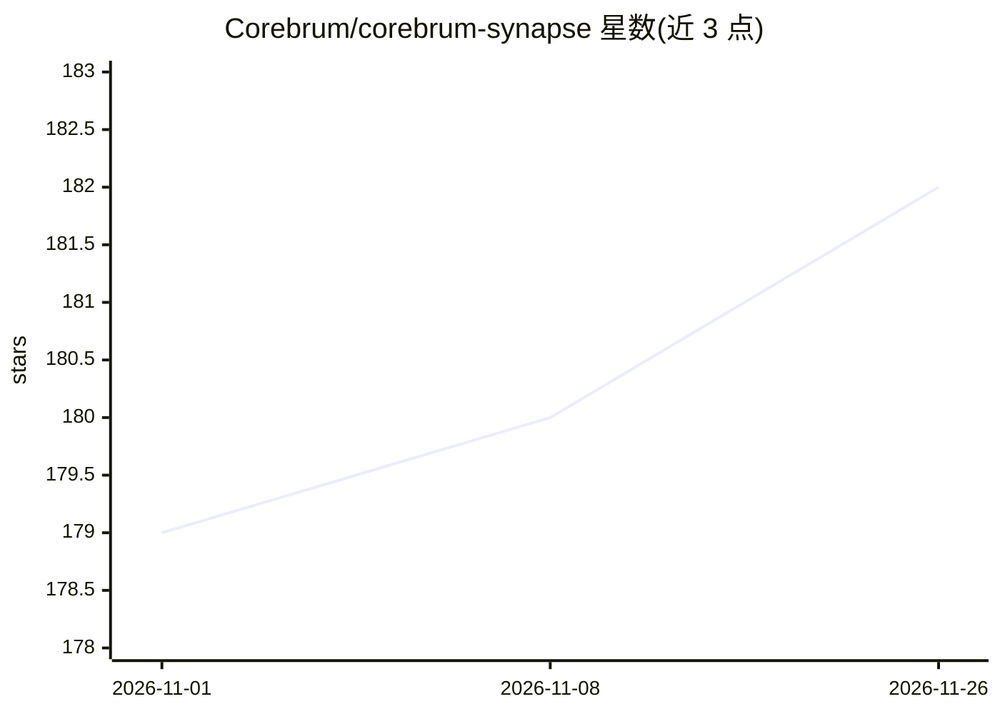

# Corebrum/corebrum-synapse

⭐ 182 · C · Apache-2.0 · 推送 2026-11-16 · [GitHub](https://github.com/Corebrum/corebrum-synapse) · [官网](https://corebrum.com/synapse) · 组织维护

**把 ROS 2 机器人接入多 AI Agent 平台的接口层**

Corebrum Synapse 是面向 ROS 2 机器人的 agent 接口层（前身为 AgenticROS）：通过 OpenClaw 插件、MCP 服务器和 Gemini function calling 适配器，把同一套机器人工具暴露给多个 agent 平台。核心机制包括：能力清单（ros2_list_capabilities 声明 drive_base/find_object 等动词）、声明式任务链 run_mission、无 LLM 依赖的规则式自然语言目标编译、多机器人编队发现与任务取消/移交。提供 npx 一键安装 CLI，支持 Gazebo 仿真与实机两种运行方式。

## 筛选速览

| 维度 | 判定 | 备注 |
|---|---|---|
| AI 角色 | `ai-ecosystem` | LLM/agent 周边工具 |
| 许可风险 | `permissive` | Apache-2.0 |
| 部署形态 | `self-host` | docker 或自建部署 |
| 模型依赖 | local-ok | 支持本地模型 |
| 硬件要求 | — | 无带数字的原话,不猜 |
| 安装摩擦 | `low` | 无编译、无系统依赖或容器化 |
| 成熟度 | — | 结构信号不足 |

## 能力要点

- 一套 MCP 服务器覆盖 Claude Code/Desktop/Dispatch、Codex CLI、Hermes、Antigravity CLI
- 支持本地 VLM（Ollama + qwen3-vl）路径，无需云 API key
- 规则式自然语言目标编译器，运行时不依赖 LLM
- 能力清单、任务链、多机器人编队与跨 agent 任务移交

## 适用场景

- 让多种 AI agent 通过自然语言控制同一台 ROS 2 机器人
- 在 Jetson/树莓派边缘设备上用本地 VLM 驱动机器人
- 在 Gazebo 仿真中演示 AMR 或 6-DOF 机械臂任务
- 跨厂商 agent 之间共享任务记录并交接机器人任务

## 场景标签

`Agent 框架` · 领域:Agent 开发

## 证据(README 行号)

> L20: Corebrum Synapse turns ROS 2 robots into agent-native machines. Speak, type, or message — and your robot perceives,
> L36: Corebrum Synapse is built so that new adapters (LangGraph, OpenAI, local models, voice stacks, etc.) can be added w
> L65: - **Core** (`packages/core`): Platform-agnostic ROS2 transport (Zenoh, rosbridge, local DDS, WebRTC), capability/mi

## 星数曲线

2026-11-01 179 → 2026-11-26 182（+3）

---
*卡片 v1 · prompt 1.4 · 生成 2026-11-26 · 置信度 mid · 依据 README sha `f7c7dde5289d` · [字段定义](../../DATASET.md)*
