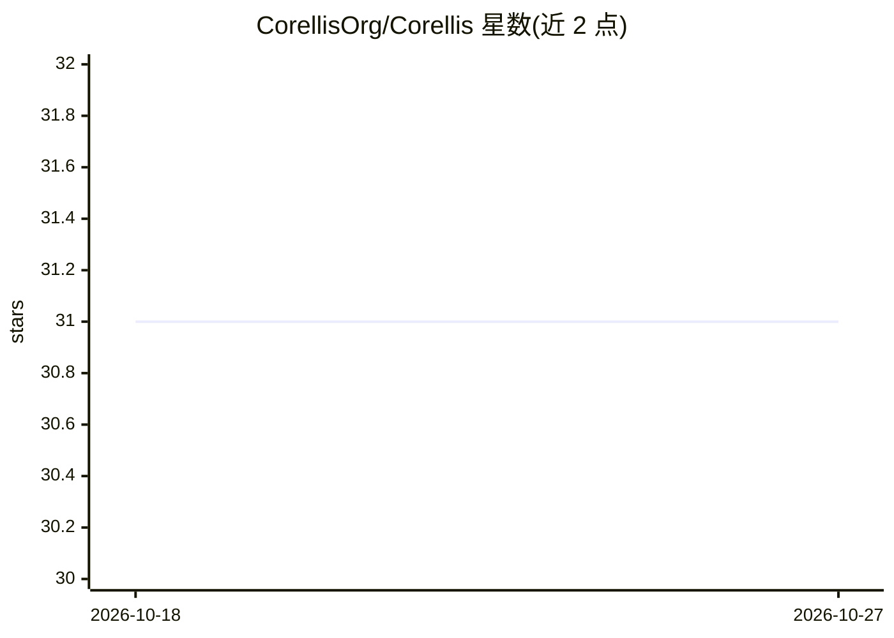

# CorellisOrg/Corellis

⭐ 31 · Shell · MIT · 推送 2026-04-13 · [GitHub](https://github.com/CorellisOrg/Corellis) · [官网](https://corellis.ai) · 组织维护

**把单个 OpenClaw 助手编排成自管理多智能体团队的开源系统**

基于 OpenClaw 的多智能体编排系统：每个团队成员拥有一个运行在 Docker 容器中的 AI 助手（lobster），共享公司知识与可语义检索的集体记忆（Teamind）。控制器在宿主机运行，负责容器管理；支持目标分解与分配（GoalOps）、统一任务板（兼容 Notion/Linear/GitHub Projects）、自我改进（错误修正全队推广）、17+ 内置技能、滚动升级与自动回滚等运维脚本。自述自 2026 年 2 月起在单台服务器上运行 28 个 lobster。部署需 OpenClaw、Docker 与 Slack 工作区，每个 lobster 需一个 Slack bot 应用。

## 筛选速览

| 维度 | 判定 | 备注 |
|---|---|---|
| AI 角色 | `ai-ecosystem` | LLM/agent 周边工具 |
| 许可风险 | `permissive` | MIT |
| 部署形态 | `self-host` | docker 或自建部署 |
| 模型依赖 | — | README 未给出锁定关系 |
| 硬件要求 | — | 无带数字的原话,不猜 |
| 安装摩擦 | `low` | 无编译、无系统依赖或容器化 |
| 成熟度 | — | 结构信号不足 |

## 能力要点

- 每成员一个 Docker 容器中的 AI 助手，4 层记忆（个人→成员→频道→公司）
- Teamind 集体记忆：Slack 会话嵌入索引，全频道语义检索
- GoalOps 目标分解、子目标分配与 P2P 交接、敏感操作人工审批
- 24 个运维脚本：滚动升级、金丝雀发布、自动回滚、健康检查

## 适用场景

- 为团队每个成员配置独立 AI 助手并共享组织知识
- 用一句高层目标驱动多智能体自动分解与协作执行
- 自托管运行一支有持久记忆与自我改进机制的多智能体团队

## 场景标签

`多智能体` `Agent 框架` `Agent 记忆` · 领域:Agent 开发

## 证据(README 行号)

> L34: Each team member gets their own AI assistant (a "lobster") running in a Docker container — with private memory and 
> L10: Turn one OpenClaw assistant into a self-managing AI workforce — lobsters that coordinate tasks, learn from their mi

## 星数曲线

2026-10-18 31 → 2026-10-27 31（+0）

---
*卡片 v1 · prompt 1.4 · 生成 2026-10-26 · 置信度 high · 依据 README sha `097abfb31926` · [字段定义](../../DATASET.md)*
